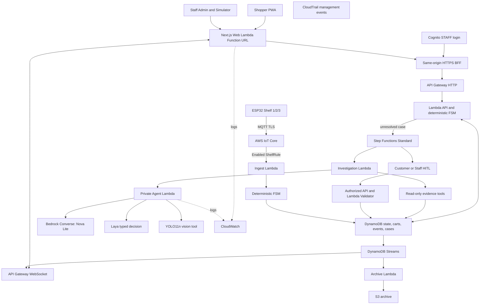

# FAST — คำตอบคำถามทีม Tech / Hardware

**อัปเดต ณ 25 ตุลาคม 2026** · อ้างอิงโค้ดใน workspace, รายงาน Cloud deployment/E2E ล่าสุด และการตรวจ AWS แบบ read-only ใน Region Singapore (`ap-southeast-1`)

> **Addendum 17 พ.ย. 2026:** มีการ deploy stack `fast-prototype` update เพิ่มและเปิด IoT แล้ว; Thing/certificate/policy สำหรับ Shelf 1–3 ถูก provision ครบ. ตรวจสถานะล่าสุดและสิ่งที่ยังไม่ได้ทำ E2E ใน [cloud-deployment-status.md](cloud-deployment-status.md). ตัวเลขค่าใช้จ่ายในคำตอบเดิมเป็นข้อมูล ณ 25 ต.ค. เท่านั้น; รอบนี้ไม่ได้ตรวจ invoice/Cost Explorer ใหม่ และ budget US$50 เป็น alert ไม่ใช่ spending cap.

> หมายเหตุสำคัญ: เอกสารคำถามตั้งต้นอ้างสถานะวันที่ 23 ต.ค. ซึ่งเก่ากว่าสถานะ deploy ล่าสุด แอป/backend และเส้นทาง AWS IoT ถูก provision แล้ว รวมถึงมีการทดสอบ Cloud flow ด้วย mock signal แต่การตรวจค่าใช้จ่ายครั้งนี้ยืนยันเฉพาะ resource/configuration ไม่ได้รันทดสอบ MQTT จากบอร์ดจริงซ้ำทุก shelf. ส่วนตัวเลขค่าใช้จ่ายแยก “ข้อมูล billing ที่ AWS แสดงแล้ว” ออกจาก “ประมาณการตามสมมติฐาน” เพื่อไม่ให้รายงานยอดคาดการณ์เป็นยอดเรียกเก็บจริง

## สรุปสถานะ

- **AWS application stack:** deploy ใน Singapore แล้ว; CloudFormation stack `fast-prototype` อยู่สถานะ `UPDATE_COMPLETE` และ Cloud E2E ที่รันด้วย mock signal ผ่านเส้นทางตะกร้า, Agent/HITL, realtime และ mock checkout ตาม scenario ที่ทดสอบ
- **AWS IoT:** live stack ตั้ง `EnableIoT=true` และมี Thing `SHELF-01/02/03`, `DevicePolicy`, Topic Rule `ShelfRule` ที่เปิดใช้งาน และ `IngestFunction` สถานะของ resource สำเร็จ จึงมีเส้นทาง MQTT → IoT Rule → Lambda provisioned แล้ว. สถานะการเชื่อม MQTT ของบอร์ดและ physical E2E ทุก shelf ต้องอ้างจากการทดสอบอุปกรณ์แยกต่างหาก
- **RAG, ตู้จ่ายเงินจริง, exit gate, กล้อง RTSP, และการวัดความแม่นยำหน้าร้าน:** ยังไม่มี/ยังไม่ทดสอบตามจริง
- **ค่า AWS:** Cost Explorer ยังไม่แสดงค่าใช้จ่ายของ stack ที่แยกยืนยันได้; stack ไม่มี cost-allocation tags และข้อมูล billing ของวัน deploy ยังไม่ครบ. มี budget alert รายเดือน US$50 ที่เตือนเมื่อถึง 80% ไม่ใช่ spending cap

### ผลตรวจ AWS IoT โดยตรง

| รายการ | ผลตรวจใน `ap-southeast-1` |
|---|---|
| IoT Things | `fast-prototype` มี 3 รายการ: `SHELF-01`, `SHELF-02`, `SHELF-03` |
| IoT policy | พบ `DevicePolicy` ใน CloudFormation stack |
| IoT Topic Rule | พบ `ShelfRule`; `ruleDisabled=false` จึงเปิดใช้งาน |
| Lambda สำหรับ ingest จาก IoT | พบ `IngestFunction` สถานะ `UPDATE_COMPLETE` |
| Parameter | `EnableIoT=true`; endpoint อยู่ Region Singapore |
| สรุป | AWS route ถูก provision แล้ว; การมี rule/Thing ไม่ได้ยืนยันว่า MQTT session ของแต่ละ ESP32 ยัง online หรือทดสอบ PICK → cart ผ่านจริงในขณะนี้ |

## A. คำตอบที่ต้องใช้ก่อนส่ง

### A1 — AWS deploy แล้วหรือยัง?

**Deploy แล้วและมีการทดสอบ Cloud flow ด้วย mock signal** ใน Region Singapore (`ap-southeast-1`). บริการใน stack ได้แก่ Next.js บน AWS Lambda Function URL, API Gateway HTTP/WebSocket, Lambda สำหรับ API/FSM/tools/validation และ IoT ingest, Step Functions Standard, DynamoDB, Cognito STAFF, S3 archive, CloudWatch, CloudTrail, AWS Budgets, AWS IoT Core และ Bedrock Converse.

โมเดลที่เรียกจาก Bedrock จริงสำหรับเลือก evidence/tool คือ `apac.amazon.nova-lite-v1:0`. การตัดสิน basket ใช้ Laya typed-decision model ที่ bundle อยู่ใน private Agent Lambda; YOLO11n เป็น visual-evidence tool ใน runtime เดียวกัน การทำงานนี้เป็น custom bounded agent loop บน Lambda ไม่ใช่ AgentCore runtime หรือ managed Bedrock Agent. AgentCore และ App Runner ไม่ได้ deploy ใน stack นี้.

Cloud E2E ที่ทดสอบเพิ่มใช้ authenticated staff simulator แทน signal จาก ESP32: clear PICK, duplicate event, PUT_BACK, ambiguous PICK → Bedrock เลือก evidence tools → Laya ให้ candidate/confidence → staff HITL → validator → cart, realtime Shopper update, mock checkout และ Stat Query. เคสกำกวมตัวอย่างหนึ่งได้ confidence 44% จึงไป staff; ตัวอย่างนี้ไม่ใช่ค่าเฉลี่ยหรือการรับรองความแม่นยำ

**ข้อจำกัดที่ต้องเขียนกำกับ:** CloudFormation provision IoT Rule → IngestFunction แล้ว แต่ผลนี้ไม่ได้ยืนยันการทดสอบ hardware MQTT/PICK → cart ครบทุกบอร์ดในรอบตรวจค่าใช้จ่ายนี้; การชำระเงินเป็น mock และ camera live inference บน AWS ยังต้องผ่าน acceptance. Screenshot ที่มีคือภาพ UI/ผล Stat Query จาก Cloud E2E ไม่ใช่ screenshot AWS Console หรือ CloudWatch Logs. ไฟล์ภาพ UI: [cloud-e2e-stat-query-proof.png](../data/cloud-e2e-stat-query-proof.png). รายงาน deployment: [cloud-deployment-status.md](cloud-deployment-status.md) มีบรรทัดสถานะ IoT ที่เก่ากว่าการตรวจ AWS ล่าสุดในคำตอบนี้.

### A2 — ค่า AWS ต่อร้าน / ค่า services ที่ deploy

**ตรวจแบบ read-only วันที่ 25 ต.ค. 2026, Region Singapore (`ap-southeast-1`). ยังไม่มีบิลจริงรายเดือนที่ยืนยันค่าใช้จ่ายของ FAST ได้**:

| ตรวจจาก | ผล | สิ่งที่แปลได้ |
|---|---|---|
| AWS Cost Explorer, 1–26 ต.ค., group by service | พบ `AWS CloudTrail` US$0.00; ผลเป็น `Estimated=true`; วันที่ 25 ต.ค. ยังไม่มีรายการ service | เป็นข้อมูลช่วงต้น/ยังประมวลผล ไม่ใช่ final bill และไม่ใช่หลักฐานว่าทุก service ฟรี |
| CloudFormation `fast-prototype` | ไม่มี stack tags (`Tags=[]`) | Cost Explorer แยกค่าใช้จ่ายเฉพาะ FAST/ต่อร้านจาก account ไม่ได้ในตอนนี้ |
| AWS Budget | US$50/เดือน แจ้งเมื่อ actual cost เกิน 80% (US$40) | เป็นการเตือน ไม่ใช่เพดานหรือการหยุดบริการอัตโนมัติ |

stack เพิ่งอัปเดตในวันที่ 25 ต.ค. จึงเร็วเกินไปที่จะใช้ Cost Explorer สรุปเดือน. เลข US$80–150/ร้าน/เดือนจากเอกสารเดิม **ยังไม่มีหลักฐานรองรับและไม่ควรนำเสนอเป็นราคา AWS ของ prototype**.

#### ค่าใช้จ่ายที่ประเมินจาก resource ที่ตรวจพบ

| Service / resource ที่ deploy | คิดค่าใช้จ่ายอย่างไร | ตัวเลขที่คำนวณได้ / ข้อจำกัด |
|---|---|---|
| **Amazon ECR** — private repos สำหรับ Agent และ Web | คิดตาม GB-month ของ image ที่เก็บ | ตรวจพบ image 6 ชุดฝั่ง Agent และ 3 ชุดฝั่ง Web รวมประมาณ **10.82 GB**. ที่อัตราอ้างอิง AWS US$0.10/GB-month คิดเป็นราว **US$1.08/เดือน** เฉพาะ image storage. Tags เก่ายังอยู่; lifecycle rule ลบเฉพาะ image ที่ไม่มี tag จึงไม่ลบ image ชุดเหล่านี้เอง. [ECR pricing](https://aws.amazon.com/ecr/pricing/) |
| **CloudWatch Alarms** — 14 alarms ใน stack | คิดราย alarm metric; logs คิดตาม ingestion/storage/query | ที่ราคาอ้างอิง US$0.10/metric-alarm-month เป็น **US$1.40/เดือนก่อน free allowance**; หากบัญชียังใช้สิทธิ์ 10 alarms ฟรีได้ จะเหลือประมาณ **US$0.40/เดือน**. Log groups ตั้ง retention 14 วัน; ค่า log ขึ้นกับปริมาณจริง. [CloudWatch pricing](https://aws.amazon.com/cloudwatch/pricing/) |
| **AWS Lambda** — Web 2,048 MB, Agent 3,008 MB, function อื่น ๆ โดยมาก 512 MB | จำนวน requests + memory × billed seconds; ไม่มีค่าเครื่อง idle แบบ EC2 | Agent cold initialization ที่วัดได้ 176 วินาที ที่ 3,008 MB เท่ากับราว 517 GB-s หรือ **US$0.0086 compute ต่อ cold invocation** ที่ราคาอ้างอิง x86 US$0.0000166667/GB-s (ก่อนคิด free tier/ส่วนลด). งานจริงคิดตามเวลาที่ invoke; Agent/Laya/YOLO อยู่ใน Lambda image ไม่ใช่ EC2/SageMaker ที่เปิดค้าง. [Lambda pricing](https://aws.amazon.com/lambda/pricing/) |
| **AWS IoT Core** — เปิด `EnableIoT=true`, 3 Things, active Topic Rule, `IngestFunction` | Connection minutes, MQTT messages, rule triggers และ actions | ตัวอย่างเพื่อให้เห็นขนาดค่าใช้จ่าย: 3 shelves online 24/7 เดือนละ 30 วัน = 129,600 connection minutes; ถ้าเกิด 60,000 MQTT events (<5 KB) และหนึ่ง rule/action ต่อ event จะอยู่ราว **US$0.09/เดือน** ตามอัตราอ้างอิงจากตารางตัวอย่าง AWS (ยังไม่รวม ACK/retry และราคาจริงของ Singapore). เป็น workload สมมติ ไม่ใช่ยอดที่วัดจากบอร์ด. [IoT Core pricing](https://aws.amazon.com/iot-core/pricing/) |
| **Step Functions Standard** | จำนวน state transitions ของแต่ละ case รวม retry | มี 4,000 transitions ฟรี/เดือนตาม AWS. ตัวอย่างสมมติ 3,000 low-confidence cases × 5 states (Investigate → Route → Staff Approval → Validate → Done) = 15,000 transitions; ใช้อัตราอ้างอิง N. Virginia US$0.000025/transition จะประมาณ **US$0.28** หลัง free tier. Singapore rate และจำนวน transition ที่ใช้จริงให้ยืนยันใน Calculator. [Step Functions pricing](https://aws.amazon.com/step-functions/pricing/) |
| **Amazon Bedrock Converse — Nova Lite** | input/output tokens; เรียกเฉพาะตอน Agent/feature ใช้ model ไม่คิดค่า model แบบเปิดค้าง | readiness call ที่บันทึกไว้ 508 input / 78 output tokens; ที่ราคาอ้างอิง Nova Lite US$0.06/M input + US$0.24/M output จะประมาณ **US$0.00005 ต่อ call**. หนึ่ง investigation อาจเรียก model หลายรอบและ prompt แต่ละรอบยาวกว่า readiness call; ยังไม่มี token aggregate ต่อ case จึงยังคูณเป็นค่าใช้จ่ายต่อร้านไม่ได้. [Bedrock pricing](https://aws.amazon.com/bedrock/pricing/), [AWS Nova cost reference](https://aws.amazon.com/blogs/machine-learning/prompting-for-the-best-price-performance/) |
| **DynamoDB** — 2 tables, on-demand; StateTable เปิด PITR/Streams | Read/write request units, storage และ PITR backup | ไม่มี provisioned-capacity charge รายชั่วโมง; ค่าใช้จ่ายขึ้นกับ transaction/request volume, record size, storage และ PITR. ยังไม่มี monthly request/backup volume ที่จะแปลงเป็นราคาได้. [DynamoDB pricing](https://aws.amazon.com/dynamodb/pricing/) |
| **API Gateway HTTP + WebSocket** | HTTP requests, WebSocket messages และ connection minutes | ไม่มีค่า gateway คงที่รายเดือน; ต้องมีจำนวน API calls, realtime messages และเวลาที่ client ต่อค้าง. ปริมาณจริงต่อร้านยังไม่วัด. [API Gateway pricing](https://aws.amazon.com/api-gateway/pricing/) |
| **S3 + CloudTrail** | S3 archive/log GB-month, PUT/GET และ data transfer | CloudTrail เก็บ management events ลง S3; first copy ของ management events ฟรีตาม AWS แต่ S3 storage/request ยังคิดตามใช้. Archive ปัจจุบันตั้ง lifecycle 90 วัน; ไม่มี video archive ใน flow นี้. [CloudTrail FAQ](https://aws.amazon.com/cloudtrail/faqs/), [S3 pricing](https://aws.amazon.com/s3/pricing/) |
| **Cognito / SNS / SQS / AWS Budgets** | MAU/ข้อความ/คำขอ ตามแต่ละบริการ | Cognito direct-login free tier อาจครอบคลุม user จำนวนเล็ก หาก pool/account เข้าเงื่อนไข; SNS/SQS เป็น request-based. Budget alert ปกติไม่มีค่าติดตามเพิ่มและไม่ได้หยุด spend. [Cognito pricing](https://aws.amazon.com/cognito/pricing/), [Budgets pricing](https://aws.amazon.com/aws-cost-management/aws-budgets/pricing/) |

ตัวเลขที่รู้จาก resource storage และ alarm รวมเป็นค่ารายเดือนคร่าว ๆ **US$1.48–2.48 ก่อน S3, runtime/API/database/model usage, free-tier credit และ regional adjustments**. นี่เป็นการประมาณจาก resource ปัจจุบัน ไม่ใช่ยอด bill. ค่าใช้จ่าย variable เพิ่มตาม traffic; ใน prototype ตัวที่ควรจับตาคือ Agent Lambda duration/cold start, Bedrock token ต่อ investigation, ECR image versions ที่สะสม และ CloudWatch logs.

#### ตัวอย่างหนึ่งร้าน (สมมติฐานสำหรับวาง Calculator เท่านั้น)

ตั้งสมมติฐานชัดเจน: 100 shoppers/วัน × 20 shelf events/คน × 30 วัน = 60,000 events/เดือน, ambiguous 5% = 3,000 cases, 3 shelves เชื่อมตลอด 24 ชั่วโมง. จาก assumptions นี้ IoT Core ประมาณ **US$0.09/เดือน** และ Step Functions ราว **US$0.28/เดือน** ตาม public reference rates ข้างต้น. หาก Agent ใช้ 5 Bedrock calls ต่อ case และแต่ละ call มีขนาดเท่า readiness sample จะได้ Bedrock ราว **US$0.74/เดือน**; ถ้า Agent ใช้ warm runtime เฉลี่ย 20 วินาที/เคส จะได้ Lambda Agent compute ราว **US$2.94/เดือนก่อน free tier**. ตัวเลขสองรายการหลังเป็น sensitivity example เท่านั้น—token/duration ของ full case ยังไม่ได้วัด. ยังไม่รวม API Gateway, DynamoDB, S3, Ingest/API Lambdas และ log volume จึงห้ามใช้ผลรวมนี้เป็น quote หรือ claim ว่าเป็นค่าใช้จ่ายจริงของร้าน.

| ขอบเขต | คำตอบที่ปลอดภัยในเอกสารธุรกิจ |
|---|---|
| Demo | มี baseline estimate จาก ECR + alarms ประมาณ US$1.48–2.48/เดือนก่อน usage; Cost Explorer ยังไม่ออกยอดที่เชื่อถือได้ |
| 1 ร้าน | ใช้ workload assumption ตัวอย่างด้านบนเป็น draft สำหรับ Calculator; ยังไม่มี measured per-store total |
| 100 ร้าน | ยังไม่ควรคูณยอด 1 ร้านตรง ๆ: ECR/alarms/shared stack อาจแชร์กัน ส่วน requests, Bedrock, storage และ peak concurrency โตตาม traffic. ต้องกำหนด tenant model และวัด 1 ร้านก่อน |

**ไม่รวมในประมาณการ:** AgentCore และ App Runner ไม่ได้ deploy; ไม่มี EC2, RDS หรือ NAT Gateway ใน stack นี้ จึงไม่มีค่าเครื่องเหล่านั้นแบบเปิดทิ้งไว้. Bedrock rate, AWS service rates และ free-tier eligibility ให้ตรวจซ้ำใน [AWS Pricing Calculator](https://calculator.aws/#/) โดยเลือก `ap-southeast-1` ก่อนนำตัวเลขไปเสนอ.

### A3 — เอา Customer YES/NO เมื่อ confidence ≥ 0.75 ออกหรือยัง?

**ยังไม่ได้เอาออก:** policy/code ยังมี Customer Confirmation สำหรับกรณีที่ candidate ผ่านเงื่อนไข confidence (ค่าเริ่มต้น 0.75) และ evidence อื่นไม่ขัดแย้ง. Customer ตอบ NO, หมดเวลา, หรือ validator พบ conflict จะถูกส่ง Staff HITL. Cloud E2E ล่าสุดที่ทดสอบได้ 44% จึงถูก route ไป staff; ยังไม่ได้พิสูจน์ customer YES/NO path ด้วย Bedrock score ≥ 0.75 ใน Cloud E2E.

ดังนั้นข้อความ “ลูกค้าไม่ต้องกดอะไร” ยังไม่ตรงกับ behavior ปัจจุบัน หาก business ต้องการให้ ambiguous ทุกเคสเข้าคิว staff ต้องปิด Customer Confirmation branch และทดสอบ Customer NO/timeout ให้ไม่สามารถเพิ่มรายการเข้าตะกร้าได้.

### A4 — Agent แสดงแผนที่มองเห็นได้ครบหรือยัง?

**มี trace การทำงานทีละขั้น แต่ยังไม่ใช่แผนรวมล่วงหน้าครบทุกช่อง:** Dashboard แสดง case, evidence, action/tool ที่โมเดลเลือก, observation/result, confidence, recommendation และ next action ได้. ตัว agent เลือกเครื่องมือจาก allowlist ตามหลักฐานที่ยังขาดและหยุด/ส่ง staff ได้.

ยังไม่ได้ยืนยัน UI ที่แสดงเป้าหมาย → หลักฐานที่ต้องการทั้งหมด → tool plan → ความไม่แน่นอนที่เหลือเป็นแผนเดียวก่อนเริ่มสืบสวน. ควรอธิบายสไลด์ว่าเป็น **visible step-by-step investigation trace** ไม่ใช่แผนงานครบที่เขียนไว้ก่อน agent เริ่ม. ภาพหน้าจอ local trace: [admin-audit.png](fast-tech-evidence/screenshots/agentic-system/admin-audit.png).

### A5 — มี RAG จากคู่มือร้านหรือยัง?

**ยังไม่มี RAG.** ไม่มี Bedrock Knowledge Base, vector store, embeddings, document ingestion/chunking, หรือการอ้าง section จาก SOP/คู่มือ. การอ่าน shelf events, basket RSSI และ cart history ผ่าน tools เป็น structured database retrieval ไม่ใช่ RAG. ยังไม่มี query → retrieved section → คำแนะนำที่มี citation ให้สาธิต.

### A6 — ฟุตเทจ demo 3 ฉาก รวม 4:45 นาที

ได้รับ clip `IMG_0465.MOV` และนำไปทำ/ปรับ YOLO detection กับ map ใน prototype แล้ว แต่ **ยังไม่มีหลักฐานยืนยันว่าตัดต่อฟุตเทจสุดท้ายครบสาม demo ยาว 4:45 นาทีแล้ว**. ชื่อผู้ถ่าย, เวลาที่ทำเสร็จ, ความยาวจริง และขนาดไฟล์สุดท้ายยังไม่ยืนยัน จึงไม่ควรกรอกแทน.

ฉาก Cloud ใช้ hardware signal ได้เมื่อทดสอบ physical E2E ผ่าน; ถ้าใช้ staff simulator ให้ติดป้าย **SIMULATED SIGNAL**. เส้นทาง IoT Rule → IngestFunction ถูก provision แล้ว แต่การ provision ไม่แทนผลทดสอบหยิบสินค้าจริงครบทุก shelf. ฉากกล้องควรระบุว่าเป็น YOLO11n prototype และภาพ/map ยังต้อง calibrate; ไม่อ้างว่าเป็นกล้อง overhead ที่ผ่านการทดสอบร้านจริง.

### A7 — ยืนยันข้อความเทคนิคใน Project Summary/สไลด์

ข้อความเดิมในคำถามไม่ตรงกับ deployment ล่าสุดทั้งหมด ให้แก้เป็น:

- **Bedrock:** เรียก Amazon Bedrock Converse จริง โดยใช้ inference profile `apac.amazon.nova-lite-v1:0` เพื่อเลือก action/tool ที่อนุญาต
- **Agent runtime:** custom bounded investigation loop อยู่บน private Lambda container; ไม่ได้ deploy AgentCore และไม่ได้สร้าง managed Bedrock Agent
- **Basket decision:** ใช้ Laya typed-decision model ที่ bundle ใน runtime เพื่อเสนอ candidate/confidence; ระบบยังคงต้องผ่าน deterministic policy/validator/HITL ก่อนเปลี่ยน cart
- **Vision:** YOLO11n เป็น tool สำหรับตรวจ evidence จากภาพ/clip; ไม่ใช่หลักฐานว่า YOLO ระบุ SKU หรือผู้หยิบได้ถูกต้องในหน้าร้าน และ live camera บน Cloud ยังรอ acceptance
- **AWS:** app/backend หลัก deploy แล้วใน Singapore; live stack เปิด IoT และมี 3 Things, Topic Rule กับ IngestFunction. ให้แยกการ provision ของเส้นทางออกจากการยืนยัน physical E2E. Bedrock ใช้งานจริง ไม่ใช่แค่เตรียมไว้. RAG, AgentCore และ App Runner ไม่ได้ใช้ใน runtime ปัจจุบัน

**บริการที่ใช้งานจริงใน stack:** AWS Lambda, API Gateway HTTP/WebSocket, Step Functions Standard, DynamoDB, Cognito (staff), S3 archive, CloudWatch, CloudTrail, AWS Budgets, AWS IoT Core และ Bedrock Converse. `EnableIoT=true`; CloudFormation มี `DevicePolicy`, `ShelfRule` และ `IngestFunction`; การทดสอบ MQTT จากบอร์ดจริงยังต้องอ้างผล physical E2E แยกต่างหาก.

### A8 — แผนภาพ Architecture สำหรับสไลด์

ยังไม่มีไฟล์ส่งออก PNG/SVG จาก AWS Console; แนบ Mermaid diagram ซึ่งสะท้อน resource ที่ deploy และจุดที่ต้องรับรองด้วย hardware test สามารถ render/export เป็น SVG/PNG สำหรับสไลด์ได้:

## B. Hardware และต้นทุนอุปกรณ์

### B1 — BOM และราคาต่อชุด

ไม่มีใบเสร็จหรือราคาซื้อจริงยืนยัน BOM ต่อสาขา. รายการนี้เป็นเพียงราคาประมาณการเดิมสำหรับ prototype ไม่ใช่ใบเสนอราคาปัจจุบัน:

| รายการ | จำนวน/รุ่นที่ระบุ | ราคาอ้างอิงเดิม | สถานะ |
|---|---|---:|---|
| ESP32 DevKit / ESP32-WROOM | 1 | ฿150–300 | รุ่น/ใบเสร็จจริงยังไม่ตรวจในคำตอบนี้ |
| Roller microswitch | 2, KW11-N/KW12 พร้อมล้อแดง | ฿50–150 รวม | ราคาประมาณ; ใช้ต้นแบบ |
| BLE beacon/iBeacon กันน้ำ IP67 | 2 สำหรับ Basket A/B; มีแผนใช้ 3 tag รวม reference tag | ฿300–800 รวมสำหรับ 2 ชิ้นตามประมาณการเดิม | ยี่ห้อ/SKU/ใบเสร็จและราคาชิ้นที่ 3 ยังไม่ยืนยัน |
| สาย, breadboard/จุดยึด, magnet/ชิ้นส่วนกลไก | 1 ชุด | ฿50–150 ตามประมาณการเดิม | ไม่ใช่ชุดติดตั้งเชิงพาณิชย์ |
| mini shelf และ demo products | 1 ชุด | ไม่มีราคายืนยัน | ชุดทดลอง ไม่ใช่ชั้นร้านที่ผ่านการรับรอง |
| pusher, exit gate, camera, payment terminal/cash box | — | ไม่มี | ไม่ได้ซื้อ/ติดตั้งใน prototype ตามหลักฐานที่มี |

สี่บรรทัดแรกเมื่อคิดตามช่วงราคาที่เขียนไว้รวมเป็นประมาณ **฿550–1,400 สำหรับ BLE 2 ชิ้น** ก่อนค่าส่ง/อุปกรณ์ที่ยังไม่รวม; ยอดนี้ไม่รวม tag ชิ้นที่ 3. ตัวเลขรวมเดิม ฿830–2,000 จึงยัง reconcile กับรายการและใบเสร็จไม่ได้ ไม่ควรอ้างเป็น CapEx จริงของต้นแบบหรือสาขา.

### B2 — เซนเซอร์บนชั้นและ Smart Pusher

ต้นแบบใช้ **roller microswitch KW11-N/KW12** ต่อหนึ่งตัวต่อ lane; ไม่ได้ใช้ load cell, optical sensor หรือ Smart Pusher. สวิตช์รายงานสถานะสินค้าว่ายังอยู่/ถูกนำออกจาก lane; debounce ใน firmware ตั้งต้น 80 ms. ไม่ได้พิสูจน์การหยิบหลายชิ้นต่อ lane, การวางผิดช่อง, restock, หรือ pusher ว่าทำงานได้จริง. Smart Pusher ให้ระบุเป็น **เป้าหมาย/แนวคิด** จนกว่าจะทำกลไกและทดสอบ.

### B3 — การ retrofit ชั้นเดิม

ยังไม่ได้วัดเวลาติดตั้ง, จำนวนช่าง, ประเภทชั้นที่รองรับ, สัดส่วนชั้นที่ retrofit ได้ หรือจำเป็นต้องปิดร้านหรือไม่. การทดสอบใช้ mini shelf; ค่าเป้าหมาย ≤16 ชั่วโมง/2 คนจากเอกสารเดิมเป็น **สมมติฐานเท่านั้น**.

### B4 — ความแม่นยำการหยิบทางกายภาพ

**ไม่มีผลทดสอบที่ให้ตัวเลข accuracy ได้.** ไม่มีชุดทดลองที่นับ ground truth สำหรับหลายคนพร้อมกัน, หยิบแล้วคืน, วางผิดช่อง, สินค้าซ้อน หรือ switch bounce ในสภาพร้าน. ไม่ยืนยันเป้าหมาย ≥98%. การทดสอบ browser/simulator ใช้พิสูจน์ software behavior ไม่ใช่ physical detection accuracy.

### B5 — RSSI และอัตรา ambiguous

ค่าที่ตั้งใน logic เป็น policy สำหรับ prototype ไม่ใช่ระยะที่ calibrate แล้ว: margin เริ่มต้น 10 dB; ตัวอย่าง `-51/-72` และ `-55/-57` เป็นตัวอย่าง/สัญญาณทดสอบ ไม่ใช่การวัดระยะที่ทำซ้ำพร้อม ground truth; minimum RSSI ที่ผู้ใช้กำหนดสำหรับ single-basket case คือ `-80 dBm`. ยังไม่มีชุดวัดระยะจริงหรือสัดส่วน ambiguous จากร้าน.

รายงาน browser scenario เก่ามี 3 ambiguous จาก 69 unique scripted events (~4.3%) แต่เป็น mix ที่ test script กำหนด ไม่ใช่ความถี่ที่คาดได้ในร้าน. ไม่ควรใช้สมมติฐาน 5%/30% เป็นค่าที่วัดแล้ว. BLE ใช้เป็น proximity evidence เท่านั้น ไม่ยืนยันตัวบุคคลหรือผู้หยิบ; เมื่อไม่มีสัญญาณให้ `ZONE_UNKNOWN` และไม่โยนสินค้าไปอีก Basket.

### B6 — ระบบตรวจการออก/ประตูร้าน

ไม่มี exit gate, controller, emergency release, fail-open-on-power-loss design หรือระบบกัน Guest เข้าร้าน. QR ใน prototype ใช้ผูก Basket กับ shopper session ไม่ใช่ access control ของประตู. ข้อกำหนดด้านความปลอดภัยและทางออกฉุกเฉินต้องออกแบบแยกกับผู้เชี่ยวชาญก่อน pilot.

### B7 — กล้องเฉพาะเหตุ

มี YOLO11n detection จาก clip ที่ให้มา และ code path สำหรับเปิดกล้องเครื่องของพนักงาน/ส่งภาพเพื่อ evidence; ไม่ได้ต่อ RTSP/NVR และไม่มีกล้องเฉพาะเหตุที่ยืนยันรุ่น. การ capture เริ่มจากการเปิดกล้อง/ขอภาพ ไม่ใช่ pre-event rolling buffer. ไม่พบ pipeline เก็บ video/evidence image ใน S3; archive ปัจจุบันเป็นข้อมูล audit/business ตาม retention ที่ตั้งไว้ ไม่ใช่ footage. ไม่มี retention/deletion workflow ที่ผ่าน privacy approval. Live camera inference บน AWS ยังต้องทดสอบสิทธิ์กล้อง, latency และ storage behavior ก่อนอ้างว่าใช้งานได้.

### B8 — ตู้จ่าย/เงินสด

ไม่มีตู้จ่าย, QR payment rail, card terminal, cash acceptor/change machine หรือการเก็บรักษาเงิน. Checkout ปัจจุบันเป็น mock และ receipt ระบุไม่เรียกเก็บเงินจริง. ราคา/merchant/การคืนเงินยังไม่มี; เลื่อนหลัง prototype/pilot.

### B9 — วิธีเข้าร้านและผูก session

ใช้ **สแกน QR ของ Basket A/B เพื่อเริ่ม shopper session**. ไม่มี wristband/NFC/OTP และไม่มี flow ควบคุมการเข้าร้าน. การแก้กรณี QR หาย/สลับ basket ยังต้องให้พนักงานช่วย; อย่าอธิบาย QR นี้ว่าเป็นการยืนยันตัวบุคคล.

## C. Software, Security และ Metrics

### C1 — สุ่มตรวจ clear cases และข้อพิพาทรายชิ้น

Cloud E2E มี clear PICK → cart, duplicate ไม่เพิ่มซ้ำ และ PUT_BACK ลด cart กลับได้ใน scenario ที่ทดสอบ แต่ยังไม่มี randomized audit เทียบกับ ground truth จำนวนมากหรือสถิติ physical accuracy. **ไม่มีปุ่ม dispute รายชิ้นใน receipt ที่ยืนยันว่าผูกกับ case/staff workflow ครบแล้ว**.

### C2 — ตรวจตะกร้าก่อนจ่าย/แจ้งรายการผิด

Shopper แสดง cart ก่อน checkout และ checkout ถูก block เมื่อยังมี unresolved case. แต่ยังไม่มี dispute workflow แบบครบวงจรที่ลูกค้ากด “ตะกร้าไม่ถูกต้อง” แล้วสร้าง case, แจ้ง staff และ hold เฉพาะรายการจนตัดสิน. ให้ระบุเป็น **ข้อเสนอ/เป้าหมาย**; อย่าสับสนกับ Customer YES/NO ของ ambiguous case ใน A3.

### C3 — แจ้ง staff, roster และ SLA

มี Admin queue สำหรับเปิดดู/ตัดสินเคส แต่ไม่มี push/SMS/email notification สำหรับ case, ตารางเวรหลัก/สำรอง, escalation ตามเวลา หรือ SLA ที่วัดจริง. ยังไม่มีข้อมูลรับเรื่อง ≤2 นาทีหรือ Guest รอ ≤3 นาที; ตัวเลขเหล่านี้เป็นเป้าหมาย ไม่ใช่ผลทดลอง.

### C4 — Guardrails, audit และ privacy

- **Bedrock Guardrails:** ยังไม่ได้สร้าง/ผูก Amazon Bedrock Guardrails. มี application-level guardrails แทน: จำกัด action/tool เป็น allowlist, ตรวจ schema/evidence, agent ไม่มีสิทธิ์เขียน cart โดยตรง, pending/conflict ไม่เข้ายอดจ่าย, checkout block เมื่อมี unresolved case และ validator/HITL ก่อน apply decision.
- **Audit:** case timeline/event/tool calls/human decision/cart update บันทึกใน DynamoDB; application logs อยู่ CloudWatch โดย log-group retention ที่ตรวจล่าสุด 14 วัน; CloudTrail เปิดบันทึก management events; S3 ใช้ archive พร้อม lifecycle 90 วันตาม deployment config.
- **แก้ไขย้อนหลังไม่ได้:** ยังไม่มี hash chain, S3 Object Lock หรือ WORM guarantee. จึงเรียกได้ว่า audit trail แต่ยังไม่ควรเรียกว่า tamper-proof.
- **Privacy/PDPA:** ยังไม่มี privacy notice/consent flow ที่ผ่านการทบทวน. ข้อความใน UI ที่มีคือการแจ้ง mock payment/รายการ pending ไม่ใช่ประกาศความเป็นส่วนตัวหรือหลักฐาน PDPA compliance. ก่อนใช้คน/กล้องจริงต้องเพิ่ม notice, purpose, retention, deletion/contact และ consent ที่เหมาะสม.

### C5 — Latency ที่วัดได้

ผลที่มีเป็นตัวอย่างเดี่ยว ไม่ใช่ค่าเฉลี่ย/SLA:

| เส้นทาง | ผลที่มี | ข้อจำกัด |
|---|---|---|
| Clear event → Shopper | Cloud E2E เห็น cart/realtime update ทำงาน แต่ไม่มี timestamp instrumentation ที่ใช้รายงาน latency เป็น ms ได้ | ยังยืนยันเป้า <1.5 วินาทีไม่ได้ |
| Ambiguous case → recommendation | Cloud E2E ตัวอย่างหนึ่งประมาณ 37 วินาทีจาก case creation ถึง recommendation | ไม่ใช่ค่าเฉลี่ย; มีเวลารอเริ่ม investigation และ model/runtime latency |
| Local model investigation | มี local sample ประมาณ 23.8 วินาทีในรายงานเดิม | ไม่ใช่ cloud result และไม่ใช่ค่าเฉลี่ย |

ต้องเพิ่ม correlation/timestamps สำหรับ event received, FSM decision, workflow start, each model/tool step, HITL response และ UI render ก่อนรายงาน p50/p95.

### C6 — >95%, payload 250 bytes และ false-charge rate

**ยังไม่มีหลักฐานรองรับตัวเลขเหล่านี้.** ไม่วัดว่า >95% ของเหตุการณ์จริงตัดสินด้วย rule ได้; ค่า 64 clear/69 scripted events จาก test เก่าเป็นองค์ประกอบ scenario ไม่ใช่ accuracy/distribution ของร้าน. Payload 250 bytes ยังไม่มี measurement จาก packet capture ของ firmware จริง. ไม่มี dataset/denominator พอรายงาน false-charge rate; ใน scenario E2E ที่ทดสอบ unresolved items ไม่เข้ายอดและการชำระเงินเป็น mock แต่ผลนั้นไม่พิสูจน์ false-charge rate เป็นศูนย์ใน production.

### C7 — ทำไมใช้ LLM/Agent แทนกฎและกล้อง?

กฎ deterministic เหมาะกับกรณีชัดและเป็นตัวคุม cart/checkout เพื่อให้ผลทำซ้ำได้; clear transaction จึงไม่เรียก LLM. Agent ใช้เฉพาะเมื่อ evidence ขัดแย้งหรือไม่พอ เพื่อเลือก evidence tool ที่ควรเรียกต่อจาก allowlist, สรุปสิ่งที่พบและเสนอ next step. YOLO ให้ visual evidence เพิ่มได้ แต่ไม่ควรให้ LLM หรือ vision model เพิ่มยอดชำระเอง: ผลต้องผ่าน policy, validator และเมื่อความมั่นใจต่ำต้องให้พนักงานตัดสิน. เหตุผลนี้อธิบายประโยชน์ด้านการเลือกหลักฐานได้ แต่ **ยังไม่มี benchmark พิสูจน์ว่า Agent แม่น/ถูกกว่ากฎหรือกล้อง**.

## D. สถานะเรื่องที่ปิด/เลื่อนได้

| # | เรื่อง | สถานะที่ยืนยัน |
|---|---|---|
| D1 | Timestream | ไม่ได้ใช้ใน runtime ปัจจุบัน; ปิดได้ |
| D2 | Wiliot pixel | ไม่อยู่ใน prototype/pilot ปัจจุบัน; เป็นแนวทางอนาคต |
| D3 | ตัดเงินจริง/คืนเงินจริง/merchant | ยังไม่มี payment rail; checkout เป็น mock; ทำหลังการแข่งขันและก่อน pilot |
| D4 | นิยาม PICK/PUT_BACK | Firmware เริ่มต้น: สวิตช์เปลี่ยนจาก PRESENT/ปิดวงจร (`LOW`) เป็น EMPTY/เปิด (`HIGH`) → `PICK`; กลับเป็น PRESENT/ปิดวงจร → `PUT_BACK`; ใช้ debounce 80 ms. เป็นการตรวจ presence ต่อ lane ไม่ได้ระบุตัวคน, จำนวนสินค้าที่หยิบหลายชิ้น, SKU ที่วางผิด lane หรือการเติม stock ได้ครบถ้วน |

## หลักฐานและแหล่งราคา

- AWS deployment status ใน workspace: [cloud-deployment-status.md](cloud-deployment-status.md)
- Cloud runtime/config: [infra/cloud/README.md](../infra/cloud/README.md)
- หลักฐานเดิมและขอบเขตการวัด: [FAST_Tech_Data_Response.md](../FAST_Tech_Data_Response.md)
- [AWS Pricing Calculator](https://calculator.aws/#/)
- AWS official pricing: [IoT Core](https://aws.amazon.com/iot-core/pricing/), [Lambda](https://aws.amazon.com/lambda/pricing/), [Step Functions](https://aws.amazon.com/step-functions/pricing/), [DynamoDB](https://aws.amazon.com/dynamodb/pricing/), [API Gateway](https://aws.amazon.com/api-gateway/pricing/), [Bedrock](https://aws.amazon.com/bedrock/pricing/), [S3](https://aws.amazon.com/s3/pricing/), [CloudWatch](https://aws.amazon.com/cloudwatch/pricing/)
