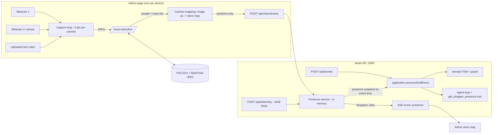

# Basket detection: camera + BLE shopper tracking

Status: **P1–P4 built locally** (see section 15 for what was built and where it differs from this design). P5 cloud and P6 measurement are not started. Branch: `basketdetection` (from `main` at `c9f5c64`).
This document records every idea and decision from the design discussion so the whole team works from the same picture. Read sections 1–4 for the idea, 5–8 for how it plugs into the existing system, 9–12 for the delivery plan.

---

## 1. Summary in one paragraph

Today a shelf event is assigned to Basket A or B using only BLE signal strength, and the camera is display-only with Basket A/B chosen by hand. We will treat **every person in the store as a shopper**, track them with one or more cameras on a shared store map, and **link a shopper to a BLE basket tag** when both are at the same shelf. A person with no tag stays an **anonymous shopper** (for example someone buying one bottle of water). At every PICK/PUT_BACK the system records **who was at that shelf** as evidence for staff and the Agent. Carts keep working exactly as today; an optional guard (off by default) can later send a pick to staff when an anonymous person was closer to the shelf than the basket the BLE rule chose.

---

## 2. What exists today (the parts this builds on)

| Area | Where | What it does now |
| --- | --- | --- |
| Shelf event FSM | `src/domain.mjs` `processShelfEvent` | Validates PICK/PUT_BACK, dedupes `eventId`, decides by RSSI: clear lead ≥ 10 dB or single active basket ≥ −80 dBm → cart update; otherwise a case. |
| Proximity rule | `src/proximity-policy.mjs` | The 10 dB / single-basket logic, shared by FSM and Agent tools. |
| Telemetry | `src/evidence.mjs` `ingestTelemetry` | 1 Hz per shelf ESP32: RSSI of tags `A`, `B`, `HV01`, lane states. Last 120 samples kept. |
| Agent investigation | `src/agent/agent-loop.mjs`, `tools.mjs` | Laya picks one read-only tool at a time, then `DECIDE` (A/B/NONE). Max 8 steps / 25 s. |
| YOLO service | `scripts/vision-service.py` (port 8001) | `/infer` (registered MOCK frames, Agent tool) and `/live` (JPEG → people + ByteTrack IDs). Max 4 live sessions, one model lock. |
| Live camera UI | `web/src/components/admin/live-customer-detection.tsx` | Browser camera → `/local-vision/live` → YOLO. Per-camera 4-corner floor calibration to a 0–1 map. Basket A/B chosen by hand. Display only. |
| Recorded replay | `tools/process-customer-clip.py`, `customer-detection.tsx` | Offline YOLO + ByteTrack on a clip, hand-assigned baskets. |
| Realtime | `src/server.mjs` `/api/stream` (SSE `state` event) | Full snapshot pushed on every change. Cloud uses WebSocket "STATE_CHANGED" + `GET /api/state`. |
| Persistence | `src/store-repository.mjs` | Local JSON (whole file rewritten on every `mutate`) or DynamoDB. |

Important constraint found while reading the code: **21 files hard-code exactly two baskets A and B** (domain, proximity policy, agent tools, Laya question `A | B | NONE`, telemetry ingest, firmware beacon MACs, Shopper app, staff actions, cloud auth/proxy). This design deliberately does **not** change that.

---

## 3. Problems we are solving

1. **Basket-less shopper.** A person with no basket takes a water bottle. The shelf hears only Basket A nearby, the single-basket rule fires, and the water is added to Basket A's cart. Wrong charge.
2. **Manual basket labels.** Staff must pick A/B for every camera track by hand, and labels are lost whenever the tracker changes an ID.
3. **ID switches.** When people cross or are hidden, one camera's tracker can swap or renew IDs.
4. **More cameras.** We want several cameras (webcams on one PC, phones, later IP cameras) and test videos, all contributing to one store view.

---

## 4. Concepts and vocabulary

Use these words consistently in code, UI and discussion.

| Term | Meaning |
| --- | --- |
| **Store map** | One floor plan drawn by staff on screen (shelves and areas). Every camera and every position uses its coordinates. Real metres are added later by typing one known length. |
| **Mapping a camera** | Clicking, on the camera image, the floor corners of shapes already on the store map. After that, the camera's people land on the map. |
| **Shelf zone** | An area on the store map in front of a shelf where a shopper "is at the shelf". |
| **Camera** | One video source with an ID (`CAM-…`): a webcam, a phone, an uploaded test video. Has its own calibration to the store map. |
| **Track** | One person as seen by one camera, with that camera's ByteTrack ID. Temporary: it ends when the tracker loses the person. |
| **Shopper** | One person in the store, made by merging the tracks from all cameras at the same floor spot. ID `S-0001`… |
| **Tag** | A BLE beacon on a physical basket (`A`, `B`). `HV01` is an asset tag and is never a shopper. |
| **Link** | "Shopper S-0007 carries tag A". Made automatically by the link rule or by staff. |
| **Anonymous shopper** | A shopper with no link: no tag, or not yet proven. Still counted, tracked and shown. |
| **Presence snapshot** | A small record of which shoppers were in a shelf zone at a moment, saved with a shelf event. |
| **Guard** | The optional rule that sends a clear pick to staff when presence contradicts BLE. Off by default. |

Key idea: **BLE gives a stable identity with a rough position; the camera gives a good position with an unstable identity.** Linking them gives both.

---

## 5. Decisions (from the design discussion)

| # | Question | Decision | Why |
| --- | --- | --- | --- |
| Q1/Q2 | What is a "basket"? | Every person is a shopper. A physical basket (BLE tag) is optional and linked to a shopper. | Matches real shopping; BLE already locates tags, the camera only makes it more accurate. Same privacy policy as BLE. |
| Q3 | What are extra cameras for? | All cases: coverage of different areas, several angles on the same area, one camera per shelf. | Preparing the system for any layout. |
| Q4 | Camera types for the prototype | Several webcams on one PC, phones opening Admin, and **uploaded test video**. IP/RTSP later. | Cheap, local, no new server-side video capture. |
| Q5/Q6 | How far this branch goes | Display + **pick evidence**. Dynamic N-shopper carts are a later branch. | Proves the camera on real picks without risking carts. |
| Q7 | How a shopper links to a phone/payment | **Undecided.** Design the shopper ID so entrance check-in or checkout claim can be added later. | Not needed for evidence. |
| Q8 | Same person on several cameras | Merge by **floor position on one shared store map**. First milestone may keep cameras separate. | Works for overlapping cameras without an appearance model. |
| Q9 | Uploaded video processing | **In the browser**, through the same `/live` path as a webcam. | Tests exactly the live code path; no file upload to the server. |
| Q10 | Base branch | Build on **`main`**. `feat/indoor-positioning` (BLE metre positioning, 7 commits, 11 conflicting files) is left out for now. | `main` is the integrated version. |
| Q11 | Camera calibration | Click ≥ 4 floor points on the camera image and the same points on the store map → camera-to-map transform. Refined by Q16. | Every camera lands in the same coordinates. |
| Q16 | How staff set up the map and cameras | **Draw** shelves and areas on screen in a map editor; **map each camera** by clicking the corners of those shapes in its image; shapes missing from the map can be drawn on a mapped camera image. People are positioned as soon as every camera is mapped. **Real measurements are optional and added later** (type one known length). | Easy setup without a tape measure; nothing has to be redone when measurements arrive. |
| Q12 | Link rule | **Strict.** Link only when sure; otherwise keep the previous link or stay anonymous. Staff override always wins. | A wrong link is worse than no link. |
| Q13 | Where matching runs | **On the API server.** Cameras send positions (no images); server merges, links, keeps short history. | Needed for multi-camera and for pick evidence. |
| Q14 | Link precision without metre BLE | **Zone level**: shopper and tag at the same shelf, and the shopper alone there. Two people at one shelf → wait, do not guess. | `main` BLE knows "nearest shelf", not metres. Good enough for 3 separated shelves. |
| Q15 | Guard on clear picks | **Off by default** (setting to turn on). Evidence is always recorded. | Carts unchanged until the camera is measured on real picks. |
| — | People crossing | Multiple angles fix most swaps: merging prefers the camera with the clear view. | One camera sees an overlap; another sees them apart. |
| — | Defaults | Track history 2 minutes in memory. Link: same zone ≥ 3 s, alone. Link kept until contradicted. | Starting values; tune in the store. |

---

## 6. Architecture



Data rules:

- **Images never leave the vision path.** The browser sends JPEGs to YOLO (as today) and sends only floor positions to the API.
- **Presence lives in memory, not in the repository.** `LocalJsonRepository.mutate` rewrites the whole JSON file; 2 fps × N cameras would thrash it. Only the small presence snapshot attached to a shelf event is persisted, inside the event/case like other evidence.
- **Presence has its own stream.** The `state` snapshot is large and is rebuilt per change; store-map and presence updates go out on a separate SSE stream, `/api/vision/stream`, at most 2 presence updates per second. (A separate stream, not a new event name on `/api/stream`, because existing readers of `/api/stream` treat every message as a full state snapshot.)

---

## 7. Component design

### 7.1 Store map: drawn in the Admin page, measured later

The store map is **drawn by staff on screen**, not typed into a file. No tape measure is needed to start.

- **Map editor** (Admin page): a floor plan. Staff drag boxes for:
  - **Shelves**: each one picks its shelf ID (`SHELF-01`… from `SHELF_IDS` in `src/shelves.mjs`).
  - **Areas**: entrance, cashier, walkway or any named area.
  - Move (drag the box), resize (drag any corner square), **turn** (drag the round handle; 5° steps, Shift for any angle; or type the angle, or ↺/↻ 15°), rename, delete.
  - **Ctrl+Z** undo, **Ctrl+Y** / **Ctrl+Shift+Z** redo (also buttons). Keyboard: arrows move, Shift+arrows resize, R turns 15°, Delete removes.
  - Shapes store `angle` in degrees; zones and distances on the server follow the turned shape.
- **Units without measurement**: the map uses its own units. Until it is measured, the system **assumes the whole map is 10 m wide** so the distance rules (0.75 m merge, 1 m re-link) still work approximately. The map shows "scale: assumed" in the corner.
- **Add measurement later**: staff pick any shape edge and type its real length ("Shelf 1 is 1.6 m wide"). The whole map gets a real scale. Nothing else changes: shapes, camera mappings and positions all stay; only the metre numbers become correct.
- **Saved on the server** so every device (PC, phones) sees the same map: `GET/PUT /api/store-map`, stored in `data/store-map.json` (outside the demo state, so Admin **Reset** does not erase the map). Loader/validator: `src/store-map.mjs` (shapes inside the floor, known shelf IDs, at most 24 shapes, size limit).

```json
{
  "version": 1,
  "width": 100, "height": 70,
  "metresPerUnit": null,
  "shapes": [
    { "id": "s1", "kind": "shelf", "shelfId": "SHELF-01", "label": "Shelf 1", "x": 10, "y": 8, "w": 20, "h": 8 },
    { "id": "a1", "kind": "area", "label": "Entrance", "x": 40, "y": 62, "w": 20, "h": 8 }
  ]
}
```

- `metresPerUnit: null` means "not measured yet" (the assumed 10 m width applies).
- A shelf's **zone** (where a shopper counts as "at the shelf") is the shelf box grown by 1 m on every side (simpler than "in front of", and works whichever side shoppers stand).
- The `feat/indoor-positioning` branch also has a layout editor (`src/store-layout.mjs`). If it is merged later, the two editors should become one.

### 7.2 Mapping each camera: drag the outlines to fit

Staff map a camera by **dragging outlines**, not by clicking corners in a fixed order (the first version did that; it was easy to get the order or the shelf's angle wrong, and the result did not match).

1. Press **จับคู่กล้องกับแผนที่**. The frame freezes and **every shape on the map is drawn on the image as an outline** with a round handle at each corner (a rough starting guess, or the saved mapping if there is one).
2. Drag a corner handle onto the matching **floor corner** of that shelf or area in the picture. While fewer than 4 corners are placed, the other corners of that shape stay put, so it behaves like dragging one corner of a sheet. **All other outlines move with it immediately.**
3. Finish one clearly visible shelf (4 green corners), then fix any other outline that is still off. Every placed corner counts: with more than 4 the mapping is a best fit (least squares) over all of them.
4. **Ctrl+Z** undoes the last move. Keyboard: **N** picks the next corner, arrows move it (Shift = bigger steps).
5. When every outline sits on the real shelves and areas, press **บันทึก**.

Technical notes:

- `fitHomography` in `web/src/lib/camera-calibration.ts`: exact for 4 points, least squares for more, any order; nearly collinear sets are rejected.
- **Shape missing from the map?** On a mapped camera, **วาดพื้นที่จากกล้องนี้**: click its 4 floor corners on the image and it is added to the map as an area.
- The mapping is saved on the server with the map (`cameras` section of `data/store-map.json`, keyed by camera ID and resolution), so a reloaded page or a phone reopening Admin does not need to map again. It is dropped when the resolution changes. The browser converts each person's foot point to map units before sending, so the tracks API never needs the mapping.
- The foot point stays "bottom-centre of the person box", as in today's code and `process-customer-clip.py`.

### 7.2a When every camera is mapped

Every person seen by any mapped camera appears on the one store map, as a shopper, and is linked to a basket tag when the link rule (7.7) is met. Nothing in this depends on real measurements; measuring later only makes the distance rules exact.

### 7.3 Camera sources on the Admin page

- **Several cameras on one page**: a camera list; each entry has its own `<video>`, capture loop, ByteTrack session (`X-Camera-Session` UUID) and calibration. Limit: the YOLO service allows **4 live sessions** and serialises inference behind one lock.
- **Phones**: unchanged flow, each phone is its own camera ID. HTTPS rules from `docs/admin-controls-camera.md` still apply.
- **Uploaded test video**: the file is opened locally in the browser (`URL.createObjectURL`), played in a `<video>`, and fed to the same capture loop. Nothing is uploaded to the server except the frames sent to YOLO (as with a webcam). These tracks are marked `source: "TEST_VIDEO"`. **Test-video presence is never attached to real shelf events** (see 7.8) unless a test-mode flag is set, because its clock is not the store's clock.

Capacity note: CPU inference measured ~100–140 ms per frame. With one model lock that is roughly 7–10 frames/s **in total**, so about 3–4 cameras at 2 fps each. More cameras need a GPU or a second YOLO process; the design does not depend on that.

### 7.4 Track ingest API

`POST /api/vision/tracks` (local API, and later the cloud handler):

```json
{
  "cameraId": "CAM-01",
  "source": "LIVE_CAMERA",
  "capturedAt": "2026-11-13T10:30:05.200Z",
  "tracks": [
    { "trackId": 7, "confidence": 0.82, "floor": { "x": 3.9, "y": 2.1 }, "box": [312, 80, 401, 350], "occluded": false }
  ]
}
```

- `source`: `LIVE_CAMERA` or `TEST_VIDEO`.
- `capturedAt`: browser clock at capture. The server stores its own `receivedAt` too and **uses receipt time as the time basis** (as shelf events already do) unless `capturedAt` is within 3 s of receipt.
- Limits: ≤ 12 tracks per message (same as YOLO `max_det=12`), body ≤ 8 KB, camera ID `^CAM-[A-Z0-9-]{1,32}$`. The browser only starts sending after the camera is calibrated.
- `box` is sent so the server can mark crossings (two boxes overlapping in one camera). `occluded` is computed in the browser: box IoU > 0.3 with another box in the same frame.
- Positions outside the store map are dropped.

### 7.5 Presence service (new, in memory)

New module `src/presence.mjs` (a deep module: small interface, all matching logic inside):

```js
createPresence({ storeMap, now })
  .ingestTracks(message)          // from 7.4
  .ingestTelemetry(sample)        // the same sample ingestTelemetry stores
  .setLink(shopperId, tagId|null, actor) // staff override
  .shoppers()                     // current view for SSE/UI
  .snapshotAt(shelfId, time)      // for 7.8
```

- Keeps 2 minutes of track samples and tag readings, bounded by count as well as time.
- Pure functions inside (`mergeTracks`, `tagZones`, `linkStep`) so they are unit-tested without a server.
- `application.mjs` owns one instance and passes it into shelf-event processing; `server.mjs` routes HTTP to it.

### 7.6 Multi-camera merge (tracks → shoppers)

- Each camera track is mapped to the store map. Distances below are in metres using the map's scale (assumed 10 m width until measured). Tracks from different cameras within **0.75 m** of each other inside the same **500 ms** window are the same shopper.
- A track keeps its shopper while it lives. When a track ends and a new track starts within **5 s** and **1 m** of where a shopper was last seen (by any camera), the new track joins that shopper. This is what carries labels through ID switches.
- **Crossing handling**: when a camera marks two tracks `occluded`, that camera's samples for them are ignored while another camera sees them clearly, so the clear view decides who is who. If no camera has a clear view, the shoppers are frozen (no relabel) until they separate. (No weighting scheme; ignore-or-use is enough until rehearsals show otherwise.)
- A shopper with no track in any camera for 5 s is closed. A closed shopper's link is remembered for 10 s for re-linking.
- First milestone may run with one camera; the merge code is the same with N = 1.

### 7.7 BLE link (shopper ↔ tag)

Tag zone from telemetry (all shelves report RSSI for `A` and `B` once per second):

- For each tag, take the median RSSI per shelf over the last 5 s.
- Tag is **at shelf X** when shelf X is the strongest, ≥ −80 dBm (same default as `SINGLE_BASKET_MIN_RSSI`), and leads the next shelf by ≥ 6 dB. Otherwise the tag zone is **unknown**. No separate hysteresis: the 5 s median and the 3 s link rule below already smooth out flicker.

Shopper zone: the shelf zone polygon containing the shopper's floor position, or none.

Link rule (strict):

1. **Link** shopper S to tag T when, for ≥ 3 s continuously: S and T are in the same shelf zone, S is the only shopper in that zone, and T is not linked to another active shopper.
2. **Keep** an existing link through zone-less walking, crossings and track changes.
3. **Unlink** when T is in a known zone for ≥ 5 s while S is clearly in a different zone, or when T has no reading for 10 s (basket left or put down).
4. **Staff override** (UI dropdown, as today) sets or clears a link. It is never undone automatically, except when the tag disappears for 10 s.
5. Two shoppers at the same shelf with one tag there → no change. They keep what they had; new shoppers stay anonymous.

Every link change is logged (`PRESENCE_LINKED` / `PRESENCE_UNLINKED`, actor `PRESENCE` or `STAFF`) in the audit log through `addAuditEntry` (rate-limited, link changes only, not every sample).

### 7.8 Pick evidence

When a shelf event arrives, `application.processShelfEvent` asks the presence service for `snapshotAt(shelfId, receivedAt)` **before** the domain runs (same pattern as `mockVisionFrameId` today), and passes it in:

```json
"presence": {
  "status": "AVAILABLE",
  "at": "2026-11-13T10:30:05.200Z",
  "windowMs": 1500,
  "cameras": ["CAM-01", "CAM-02"],
  "inZone": [
    { "shopperId": "S-0007", "tag": "A", "linkedBy": "PRESENCE", "distanceM": 0.4 },
    { "shopperId": "S-0009", "tag": null, "distanceM": 0.8 }
  ],
  "source": "LIVE_CAMERA"
}
```

- `status`: `AVAILABLE`, `NO_CAMERA` (no calibrated camera covers that shelf zone), `STALE` (no samples in the window).
- Stored on the event (`event.presence`) and copied into case `evidence.presence`. Small: ≤ 6 shoppers.
- `TEST_VIDEO` samples are included but labelled (`source` in the snapshot), so rehearsal videos can be replayed against simulator events. The guard (7.9) ignores them.
- **New Agent tool `get_shopper_presence`** in `src/agent/tools.mjs`: returns the snapshot for the case's event. Added to `TOOL_DESCRIPTIONS`, to `observationSummary` in `agent-loop.mjs`, to `infra/bedrock/agent-functions.json` and `infra/bedrock/agent-instructions.md`. Description must say: "proximity on camera, not proof of who picked; a tag link is a zone-level association".
- `DECIDE` context (`decision-contract.mjs`) is **not** changed in the first version: the Laya basket question still answers A/B/NONE and sees presence only through the investigation summaries.

### 7.9 Guard (off by default)

- Setting: `PRESENCE_GUARD=off|on` (env, default `off`), shown in `snapshot().policy`.
- Applies only when the FSM would update a cart automatically (CLEAR zone, including `SINGLE_ACTIVE_BASKET`).
- Rule: if the snapshot is `AVAILABLE`, its source is `LIVE_CAMERA`, and an **anonymous** shopper is in the shelf zone **closer** than the shopper linked to the chosen basket (or the chosen basket's shopper is not in the zone at all) → create a case `PRESENCE_CONFLICT`, `nextAction: STAFF_HITL`, no cart change.
- When off, the same check runs and its result is written into the audit entry `CART_UPDATED` as `presenceCheck: "WOULD_BLOCK" | "OK" | "NO_DATA"`. This is how we measure the guard before switching it on.
- The guard can only make things stricter. It never adds an item that BLE would not.

### 7.10 Admin UI

- **Store map panel** (replaces the per-camera 0–1 map): shelf zones, shoppers as dots with label `Basket A`, `Basket B` or `Anonymous`, 6 s trails, heatmap toggle (keeps today's `MapView` points/heatmap and the chat commands that switch it).
- **Camera panel list**: add camera (device picker or video file), per-camera status (fps, latency, calibrated or not), stop.
- **Map editor**: drag rectangles for shelves and areas, pick shelf IDs, name areas; "Set scale" to type one real length later (7.1).
- **Camera mapping**: freeze the frame, drag the map's outlines onto the real shelves, Save (7.2). "Add shape from this camera" draws a missing area on a mapped camera image.
- **Setup status**: a checklist per camera ("not mapped / mapped") so staff see when every camera is ready.
- **Shopper list**: shopper ID, link, how it was linked (auto/staff), cameras seeing them, link dropdown (override).
- **Case details**: new "Presence at event" block showing `evidence.presence`.
- The recorded replay ("คลิปจริง") stays as it is.

---

## 8. Integration checklist (every touchpoint)

Backend:

| File | Change |
| --- | --- |
| `src/store-map.mjs` (new), `data/store-map.json` (created at runtime, ignored by Git like the rest of `data/`) | Store map + camera mappings: format, validation, load/save. Routes `GET/PUT /api/store-map` in `src/server.mjs`. |
| `src/presence.mjs` (new) | Presence service (7.5–7.7). |
| `src/application.mjs` | Own a presence instance; `ingestVisionTracks`, `setPresenceLink`; feed telemetry samples to presence; pass `snapshotAt` into `processShelfEvent`; emit presence updates. |
| `src/domain.mjs` | Accept `input.presence`, store it on the event and case evidence, guard in the CLEAR branch, `presenceCheck` in `CART_UPDATED` audit, `policy.presenceGuard` in `snapshot`. Nothing else in the FSM changes. |
| `src/server.mjs` | Routes: `POST /api/vision/tracks`, `POST /api/presence/links`; SSE event `presence`. **Also update `web/tests/helpers/local-api.mjs`**, which rewrites `server.mjs` import lines and fails if they change. |
| `src/agent/tools.mjs`, `agent-loop.mjs` | `get_shopper_presence` tool and its observation summary. |
| `infra/bedrock/agent-functions.json`, `agent-instructions.md` | Same tool for the cloud planner. |
| `src/cloud/agent-runtime.mjs` | Allow the tool in `createCloudToolsHandler` (it currently blocks `inspect_vision_evidence` only). |
| `src/cloud/handlers.mjs`, `web/src/lib/cloud-proxy.ts` | Cloud routes and the proxy allow-list regex (phase 5). |

Web:

| File | Change |
| --- | --- |
| `web/src/lib/api/types.ts` | `Presence`, `Shopper` types; `evidence.presence`. |
| `web/src/lib/api/live-state.ts` | Listen to the `presence` SSE event (separate store, so the big `state` snapshot is untouched). |
| `web/src/lib/api/client.ts` | `postTracks`, `setLink`. |
| `web/src/lib/camera-calibration.ts` | `floorHomography` takes target points (store-map corners) instead of the fixed square; inverse projection to draw shapes on the image and to add shapes from a camera. |
| `web/src/components/admin/store-map-editor.tsx` (new) | Map editor (7.1, 7.10). |
| `web/src/components/admin/live-customer-detection.tsx` | Split into a reusable camera source (webcam / phone / video file) + capture loop that posts tracks. |
| `web/src/components/admin/customer-detection.tsx` | Add store-map mode; keep the recording mode. |
| `web/src/components/admin/case-details.tsx` | Presence block. |

Python / YOLO: no change for the first milestones. `vision-service.py` already returns people with track IDs per session.

Docs to update when built: `docs/event-contract.md` (presence field, new case type), `docs/agentic-investigation.md` (new tool), `docs/admin-controls-camera.md` (multi-camera, calibration, video), `docs/vision-evidence.md`, `README.md` safety section.

---

## 9. Delivery phases

Each phase ends with its tests passing and something visible.

| Phase | Scope | Done when |
| --- | --- | --- |
| **P1 Store map + camera mapping** | Map editor (draw shelves and areas), server-saved map, camera mapping by clicking shape corners, add-shape-from-camera, several cameras and test video on one Admin page. People are positioned per camera (merging comes in P2). Measurement optional. | A map drawn on screen, two webcams + one video mapped by clicking shapes, outlines line up on each image, and people from every camera appear on the one map, with no measurements entered. |
| **P2 Presence service** | Track ingest API, in-memory presence, multi-camera merge, `presence` SSE. | Same person seen by two cameras shows as one shopper; crossing test keeps IDs in ≥ 80% of rehearsed crossings. |
| **P3 BLE link** | Tag zones from telemetry, link rule, staff override, audit. | Basket A/B labels appear automatically in the rehearsals in section 10; a basket-less person stays Anonymous. |
| **P4 Pick evidence + guard (off)** | `event.presence`, case evidence, `get_shopper_presence`, `presenceCheck` audit, guard behind setting. | Every shelf event shows a presence block; water-bottle rehearsal records `WOULD_BLOCK`; carts unchanged. |
| **P5 Cloud** | Presence for Lambda (stateless: needs DynamoDB items with TTL or presence inside the Agent container), cloud routes, WebSocket notification. | Cloud Admin shows shoppers; cloud cases carry presence. |
| **P6 Measure, then guard on** | Run the evaluation in section 10 on real picks. | Agreed accuracy reached; team decides to set `PRESENCE_GUARD=on`. |

P1–P4 are local only and are the scope of this branch.

---

## 10. Testing and evaluation

Unit tests (Node `node --test`, like `tests/*.test.mjs`):

- store map validation (bad polygons, unknown shelf IDs);
- homography from 4 shape corners onto the store map (known square → known positions); adding a shape from a camera lands it in the right place;
- store map validation and scale: unmeasured (assumed 10 m) vs measured, shapes unchanged when the scale is set;
- merge: two cameras one person, crossing with occlusion flags, track renewal within 5 s / 1 m;
- tag zone with weak, tied and missing readings;
- link rule: link after 3 s alone, no link with two shoppers, unlink on contradiction, staff override sticks;
- snapshot window, `TEST_VIDEO` label, guard ignores `TEST_VIDEO`;
- domain: presence stored, guard off → `presenceCheck` only, guard on → `PRESENCE_CONFLICT`, duplicates unchanged.

Integration: extend `tests/integration-flow.test.mjs` and `web/tests/*.e2e.mjs` with scripted track messages + telemetry + shelf events.

Rehearsals in the store (record each with the test-video path so they can be replayed):

1. One shopper with Basket A visits Shelf 1, picks. → linked A, presence shows A only.
2. **Water buyer**: shopper with no basket picks at Shelf 2 while Basket A stands 1–2 m away. → Anonymous closer, `WOULD_BLOCK`.
3. **Crossing**: A and B walk past each other in front of Shelf 2. → labels unchanged.
4. **Two at one shelf**: A and an anonymous person at Shelf 3 together. → no relabel.
5. **Leave and return**: A walks out of all cameras for 4 s and back. → still A.
6. **Camera moved**: bump a camera. → shelf zones drawn on the image no longer line up; recalibrate. (Automatic detection of a moved camera is not in scope.)

Metrics to record: link precision (wrong links / links), link coverage (time linked / time present), ID-switch count per crossing, presence agreement with the person who actually picked (from the rehearsal script), and `WOULD_BLOCK` true/false positives. These numbers decide P6.

---

## 11. Privacy and safety

- Same policy as BLE location: we track **where** a shopper is, not **who** they are. No face recognition, no appearance features stored.
- No images are stored by this feature. Positions are kept 2 minutes in memory; only the small presence snapshot attached to a shelf event is persisted, like other evidence, and follows the existing audit retention.
- Presence never changes a cart by itself. With the guard on, it can only send a pick to staff.
- Camera and track inputs are validated and bounded like the existing `/live` route (size limits, ID formats, same-origin checks).

---

## 12. Risks and open questions

| Risk / question | Plan |
| --- | --- |
| Payment link for shoppers (Q7) | Deferred. Shopper IDs are server-generated and independent of camera IDs, so entrance check-in or checkout claim can attach later. |
| N-shopper carts | Separate branch after P6; touches the 21 A/B files listed in section 2. |
| CPU limit (one YOLO lock, ~3–4 cameras at 2 fps) | Show per-camera fps in the UI; add a second YOLO process or GPU when needed. |
| Clock differences between devices | Use server receipt time; ignore `capturedAt` more than 3 s off. |
| Zone-level BLE cannot separate two people at one shelf | Accepted (Q14). Metre positioning from `feat/indoor-positioning` can replace `tagZones` later. |
| Calibration error (feet hidden, lens distortion) | Shelf-zone overlay check, rehearsal 6, recalibrate on camera move. |
| Uploaded video mistaken for live data | `TEST_VIDEO` source label on every snapshot; the guard ignores it. |
| Cloud is stateless | P5 design choice: DynamoDB TTL items vs presence inside the Agent container. |

---

## 13. Skills for this project (Claude Code)

Skills already available in this environment that fit this work:

| Skill | Use it for |
| --- | --- |
| `ponytail` (full level) | **Default for all implementation work.** Smallest complete change, reuse existing code first, one small test for each new rule, never cut validation, security or hardware calibration. Section 14 shows what it removed from this design. |
| `domain-modeling` | Turn section 4 into a `CONTEXT.md` glossary and record decisions (section 5) as ADRs. |
| `engineering:architecture` | ADR for big choices: camera+BLE fusion, `main` vs `feat/indoor-positioning`, cloud presence (P5). |
| `codebase-design` | Keep `src/presence.mjs` a deep module with a small interface. |
| `tdd` | Build merge, tag-zone and link rules test-first (they are pure functions). |
| `prototype` | Throwaway prototype to tune thresholds (0.75 m, 3 s, 6 dB) on recorded rehearsals. |
| `engineering:testing-strategy` | Expand section 10 into a test plan. |
| `frontend-design` | Store-map panel and calibration wizard. |
| `run` | Launch the full local stack to check each phase in the real app. |
| `diagnosing-bugs` | Tracking/linking issues found in rehearsals. |
| `code-review`, `security-review` | Before each phase's pull request (new API routes accept browser input). |

`ponytail` and `tdd` work together: ponytail keeps the code small, tdd writes the one test each rule needs first. Use `ponytail ultra` when reviewing a phase plan, so it questions scope before code is written.

---

## 14. Ponytail pass: what was cut from the first draft

The first draft of this design was reviewed with the `ponytail` rules ("does it need to exist? is it already in the codebase?"). Removed:

| Cut | Why | Upgrade later if… |
| --- | --- | --- |
| N-point least-squares calibration + reprojection error | Today's 4-point `floorHomography` already works; with exactly 4 points the error is always ~0, so the number would mislead. Replaced by drawing shelf zones back on the image. | Wide-angle lenses need more points. |
| A separate cameras API | Camera mappings are saved inside the store map (`GET/PUT /api/store-map`), one route for both. (Saving on the server came back with Q16 so phones and reloads keep their mapping.) | Fixed IP cameras with server-side capture (RTSP). |
| Weighted multi-camera fusion | Ignore occluded samples when another camera is clear; freeze when none is. Simpler and testable. | Rehearsal 3 fails often. |
| Tag-zone hysteresis | The 5 s median and the 3 s link rule already smooth flicker. | Links flip in rehearsals. |
| `PRESENCE_TEST_MODE` flag | A `TEST_VIDEO` label is enough because evidence never changes carts; the guard ignores test video. | Never, unless the guard needs testing on video. |

Kept on purpose (ponytail never cuts these): input validation and size limits on the new routes, the staff override, the audit of link changes, the guard staying off by default, and per-camera calibration.

---

## 15. What was built (P1–P4) and where it differs

| Part | Files |
| --- | --- |
| Store map (server) | `src/store-map.mjs`, routes in `src/server.mjs`: `GET/PUT /api/store-map`, `PUT/DELETE /api/store-map/cameras/:id`; saved to `data/store-map.json` |
| Presence (server) | `src/presence.mjs`; `src/application.mjs` (`ingestVisionTracks`, `setPresenceLink`, telemetry feed, snapshot on shelf events); routes `POST /api/vision/tracks`, `GET /api/presence`, `POST /api/presence/links`, SSE `/api/vision/stream` |
| Domain | `src/domain.mjs`: `processShelfEvent(store, input, { presence })`, `presenceCheck`, `PRESENCE_GUARD`, case type `PRESENCE_CONFLICT` |
| Agent | `src/agent/tools.mjs` (`get_shopper_presence`), `src/agent/agent-loop.mjs`, `infra/bedrock/agent-functions.json`, `agent-instructions.md` |
| Web | `store-map-view.tsx`, `store-map-editor.tsx`, `camera-feed.tsx`, `live-customer-detection.tsx` (multi-camera board), `customer-detection.tsx` (new "แผนที่ร้าน" tab), `case-details.tsx`; `lib/camera-calibration.ts`, `lib/use-store-map.ts`, `lib/api/vision-stream.ts` |
| Tests | `tests/store-map.test.mjs`, `tests/presence.test.mjs`, `tests/presence-evidence.test.mjs`, `web/tests/camera-calibration.test.mjs` (`npm --prefix web run test:unit`) |

Differences from sections 7–8 (all ponytail cuts or fixes found while building):

- **Presence keeps current state only**, not 2 minutes of history. Trails and the heatmap are drawn by the browser from the live updates.
- **No 10 s memory of closed shoppers**: the 5 s / 1 m re-join already covers short gaps.
- **Separate SSE stream** (`/api/vision/stream`) instead of a `presence` event on `/api/stream` (see section 6).
- **Snapshot status**: `NO_CAMERA` = no camera has sent tracks in the last 2 minutes (or the shelf is not on the map); `STALE` = none in the last 1.5 s. Per-shelf camera coverage is not tracked.
- **Add shape from a camera** creates areas only; shelves keep their fixed IDs and are placed in the map editor.
- **Drag-to-fit replaced click-in-order camera mapping** after the first real try did not line up (corner order and turned shelves). Shapes can now be turned; the shelf zone is "within 1 m of the shelf box" at any angle.
- **Camera names** are typed by staff (`CAM-01`…); reusing a name reuses its saved mapping if the resolution matches.
- **Snapshot time** is the moment the server receives the shelf event (shelf events have no trusted capture time today).

Verified: backend `npm test` 80/80; web typecheck, lint and `test:unit` 3/3; web `test:e2e` (auth, Shopper, Admin, native SSE) all pass; map editor drag-and-save and the live store map checked in the browser with scripted tracks and BLE telemetry; water-buyer rehearsal through the live API recorded `presenceCheck: WOULD_BLOCK` with the cart updated as before (guard off). Drag-to-fit was checked with real YOLO11n on the demo video (`web/public/demos/customer-walk.webm`): fitting Shelf 2 alone brought the Shelf 1 and Shelf 3 outlines onto the drawn shelves. **Not yet verified**: real webcams/phones with real people, and the mouse drag in a visible browser window (checked here through the keyboard path).

---

## 16. Next: side-by-side camera + map setup (agreed 2026-11-13, in progress)

Drag-to-fit (7.2) still did not work well enough in practice. Agreed replacement:

- **Side by side**: one setup window per camera, camera picture on the left and the editable store map on the right.
- **Draw either side first**: draw a shelf/area on the map, or click its 4 floor corners on the camera picture (any order; points are sorted clockwise and the corner pairing can be turned with a ↻ button).
- **Sync buttons**: "use camera to adjust the map" or "use map to adjust the camera outlines". The mapping is a least-squares fit over every shape drawn on both sides; each shape shows its mismatch in metres until synced.
- **Check tool**: click a spot on the map and a 0.6 m box appears at that spot on the camera picture (and click on the camera to see the spot on the map), to confirm positions by eye.
- **One undo history** (Ctrl+Z / Ctrl+Y) across both sides.

Done so far: the server stores the camera outlines with each mapping (`quads` in `data/store-map.json`, validated; test in `tests/store-map.test.mjs`). Still to build: shared undo history + editor refactor, the side-by-side setup window with sync, the check tool, then browser check and docs.
