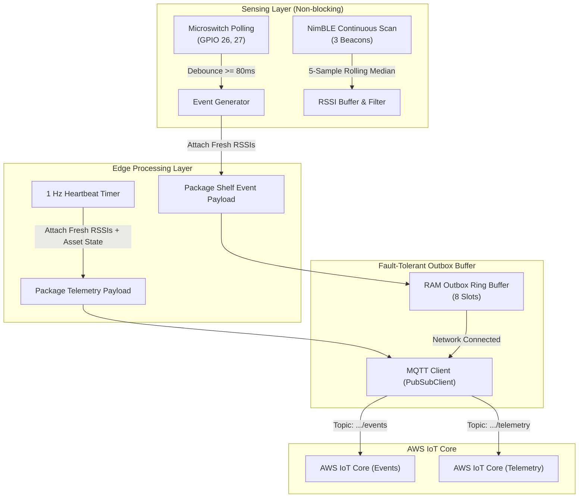

# ESP32 Firmware Requirements Specification

**Project:** SmartBasket (Basketly) - NTT DATA Hackathon  
**Target Hardware:** ESP32-WROOM-32 Dev Module  
**Document Status:** Approved Specification  
**Version:** 1.0.0  

---

## 1. Executive Summary & Purpose

This Software Requirements Specification (SRS) defines the functional, structural, and behavioral requirements for the **ESP32 firmware** powering the physical Smart Shelf (`SHELF-01`). The ESP32 operates as an **Edge Pre-processing Node**, interfacing directly with physical shelf sensors and communicating securely with **AWS IoT Core**.

### Key Objectives:
1. Detect real-time item removals and returns across two physical shelf lanes (Coke, Water) via mechanical roller microswitches.
2. Continuously scan, filter, and track signals from **three BLE Beacons**:
   - **Basket A (Tag 1):** Associated with Shopper A's basket session.
   - **Basket B (Tag 2):** Associated with Shopper B's basket session.
   - **High-Value Item (Tag 3):** Attached to a high-value asset (e.g., premium liquor/perfume `HV-001`) for proximity monitoring and anti-theft tracking.
3. Perform edge filtering (Switch Debouncing & Rolling Median Filter) to eliminate signal noise and minimize cloud bandwidth and AWS credit consumption.
4. Transmit telemetry and events over **MQTT over TLS 1.2 (Port 8883)** with an in-memory fallback outbox buffer for network resilience.

---

## 2. Hardware Architecture & Pin Configuration

| Component | Interface / ESP32 Pin | Logic Level | Operating Mode & Description |
| :--- | :--- | :--- | :--- |
| **Coke Lane Switch** | GPIO 26 | 3.3V Logic | `INPUT_PULLUP`: Product resting = `LOW` (Closed); Product lifted = `HIGH` (Open). |
| **Water Lane Switch** | GPIO 27 | 3.3V Logic | `INPUT_PULLUP`: Product resting = `LOW` (Closed); Product lifted = `HIGH` (Open). |
| **Basket A Beacon** | BLE (2.4 GHz) | Over-the-air | DX-CP101 iBeacon (Project UUID / Major 1 / Minor 1 or MAC Address). |
| **Basket B Beacon** | BLE (2.4 GHz) | Over-the-air | DX-CP101 iBeacon (Project UUID / Major 1 / Minor 2 or MAC Address). |
| **High-Value Beacon** | BLE (2.4 GHz) | Over-the-air | DX-CP101 iBeacon (Project UUID / Major 1 / Minor 3 or MAC Address). |
| **Wi-Fi & Time** | 2.4 GHz Wi-Fi Station | - | Connects to local 2.4 GHz WLAN; synchronizes UTC time via NTP. |

---

## 3. System Architecture & Data Flow



---

## 4. Functional Requirements (FR)

### FR-1: Shelf Switch Sensing & Debounce Logic
* **FR-1.1 (Lane Isolation):** The firmware must independently monitor both product lanes:
  * `LANE-1` $\rightarrow$ SKU: `COKE`
  * `LANE-2` $\rightarrow$ SKU: `WATER`
* **FR-1.2 (Debounce Duration):** An input state transition must remain stable for at least **80 ms** (`SWITCH_DEBOUNCE_MS`) before being registered as an authentic event.
* **FR-1.3 (Transition Mapping):**
  * Transition from `PRESENT (LOW)` $\rightarrow$ `EMPTY (HIGH)` triggers a **`PICK`** event.
  * Transition from `EMPTY (HIGH)` $\rightarrow$ `PRESENT (LOW)` triggers a **`PUT_BACK`** event.
* **FR-1.4 (Boot Event Suppression):** At firmware startup (`setup()`), initial switch states must be recorded as baselines without emitting any `PICK` or `PUT_BACK` events to the cloud.

---

### FR-2: Continuous BLE Scanning & Signal Filtering
* **FR-2.1 (Non-blocking Scan):** The firmware must utilize `NimBLE-Arduino` in continuous, non-blocking scan mode (Interval: ~100 ms, Window: ~65 ms).
* **FR-2.2 (Multi-Beacon Discrimination):** The scanner must independently match and track three distinct beacons:
  1. `TAG_BASKET_A`
  2. `TAG_BASKET_B`
  3. `TAG_HIGH_VALUE` (Asset ID: `HV-001`)
* **FR-2.3 (Rolling Median Filter):**
  * Maintain a circular buffer of the **5 most recent RSSI readings** per beacon.
  * Compute the **median value** when querying signal strength to eliminate radio multipath spikes and noise.
* **FR-2.4 (Freshness Window & Staleness):**
  * Beacon observation timeout is set to **5000 ms** (`TAG_FRESH_MS`).
  * If no advertising packet is received from a beacon within 5000 ms, its RSSI must be reported as `null`.

---

### FR-3: High-Value Asset Tracking Logic
* **FR-3.1 (Non-Purchasable Asset):** The high-value beacon (Tag 3) represents an asset security tag and must never trigger automatic cart additions or removals.
* **FR-3.2 (Presence State Machine):** Telemetry must evaluate and output one of three presence states for Tag 3:
  * `RECENTLY_SEEN`: Beacon detected within the last 5 seconds (asset is resting on or adjacent to the shelf).
  * `STALE`: Beacon previously seen, but no fresh advertisement received for $>5$ seconds (asset has been moved or shielded).
  * `NOT_YET_SEEN`: No advertisement has been detected since board boot.
* **FR-3.3 (Event Evidence):** When a `PICK` event occurs on any lane, the latest RSSI of the high-value tag must be included in the event payload as supporting contextual evidence for the cloud Case Manager.

---

### FR-4: Shelf Event Ingestion (Event-Driven MQTT Topic)
* **Topic Pattern:** `smartbasket/shelf/{shelfId}/events` (e.g., `smartbasket/shelf/SHELF-01/events`)
* **Trigger:** Published immediately when a stable switch transition completes.
* **Idempotency:** Every event payload must contain a globally unique `eventId` constructed from a random boot identifier and a monotonic sequence counter (e.g., `a1b2c3-42`).
* **Payload Specification (JSON):**
```json
{
  "eventId": "esp32-7f9b-0014",
  "shelfId": "SHELF-01",
  "laneId": "LANE-1",
  "sku": "COKE",
  "eventType": "PICK",
  "timestamp": "2026-10-21T13:45:00Z",
  "rssi": {
    "A": -56,
    "B": -78,
    "HV01": -48
  }
}
```
*(Note: If a beacon has no fresh reading within 5 seconds, its value must be emitted as `null`, e.g., `"B": null`)*

---

### FR-5: Periodic Telemetry & Heartbeat (1 Hz MQTT Topic)
* **Topic Pattern:** `smartbasket/shelf/{shelfId}/telemetry`
* **Trigger:** Published at a fixed interval of **1 second (1 Hz)**.
* **Purpose:** Provides continuous data for Store Heatmaps, Path Tracking, Dwell Time calculation, and High-Value Asset surveillance.
* **Payload Specification (JSON):**
```json
{
  "shelfId": "SHELF-01",
  "uptime": 3600,
  "queueDepth": 0,
  "droppedEvents": 0,
  "highValueItem": {
    "tagId": "HV-001",
    "status": "RECENTLY_SEEN",
    "rssi": -48,
    "lastSeenMsAgo": 180
  },
  "baskets": {
    "A": -56,
    "B": null
  }
}
```

---

### FR-6: Network Connectivity & Fault Resilience
* **FR-6.1 (NTP Time Synchronization):**
  * Upon establishing Wi-Fi connectivity, initialize NTP via `configTime(0, 0, "pool.ntp.org", "time.nist.gov")`.
  * Format event timestamps in ISO 8601 UTC (`YYYY-MM-DDTHH:MM:SSZ`).
  * If NTP sync has not yet completed, emit an empty string (`""`) so AWS Lambda can backfill with ingestion time.
* **FR-6.2 (Transport Layer Security - TLS 1.2):**
  * Mutual authentication using X.509 certificates (Amazon Root CA 1, Client Certificate, and Private Key) over TCP Port 8883.
* **FR-6.3 (RAM Outbox Queue):**
  * Maintain an in-memory circular ring buffer of at least **8 event slots**.
  * If MQTT or Wi-Fi drops, incoming switch events must be queued in the outbox.
  * When connectivity is restored, flush queued events in strict FIFO order.
  * If the buffer overflows, log an error to Serial and increment the `droppedEvents` counter.
* **FR-6.4 (Non-blocking Reconnection):**
  * Wi-Fi and MQTT reconnection routines must be non-blocking to prevent switch debounce sampling starvation.

---

## 5. Non-Functional Requirements (NFR)

| Metric | Target Specification |
| :--- | :--- |
| **End-to-End Latency** | Physical switch release to MQTT publish dispatch must complete within **$<150\text{ ms}$** (including 80 ms debounce). |
| **RAM Footprint** | Dynamic memory allocation must not exceed **40% of available Heap** to prevent fragmentation during long-running operation. |
| **Credential Security** | Private keys and certificates must reside exclusively in `secrets.h` and must be permanently excluded from version control (`.gitignore`). |
| **Fault Tolerance** | System must run indefinitely ($>72\text{ hours}$) without watchdog resets, heap leaks, or lockups under intermittent network conditions. |
| **Cloud Cost Efficiency** | Telemetry rate capped at 1 Hz and event-driven publishing to remain strictly within the hackathon's \$350 cloud budget. |

---

## 6. Verification & Acceptance Test Suite

| Test Case | Procedure | Expected Outcome |
| :--- | :--- | :--- |
| **TC-01: Switch Debounce & Rapid Actuation** | Actuate Coke switch rapidly 30 times within 10 seconds. | Exactly 30 alternating `PICK` and `PUT_BACK` events generated. No duplicate or ghost transitions. |
| **TC-02: Multi-Beacon Signal Discrimination** | Place Basket A at 0.5m distance and Basket B at 3.0m distance. | `rssi.A` consistently reads $\ge 15\text{ dBm}$ higher than `rssi.B`. |
| **TC-03: High-Value Asset Removal Alert** | Place Tag 3 on the shelf, then remove it beyond 5 meters. | Telemetry reflects `RECENTLY_SEEN`, transitioning to `STALE` within exactly 5 seconds of removal. |
| **TC-04: Network Outage & Outbox Flush** | Disconnect Wi-Fi Access Point; toggle switch 3 times; restore Wi-Fi. | 3 events stored in outbox; upon reconnection, all 3 events arrive on AWS IoT Core in chronological sequence with `queueDepth` returning to 0. |
| **TC-05: Cold Boot Event Suppression** | Power on the board with product resting on both switches. | Serial prints `INIT PRESENT`; zero MQTT events published until physical product state changes. |
