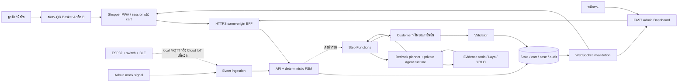
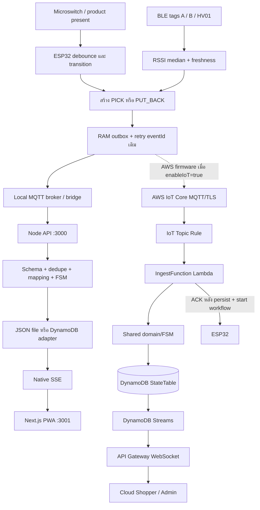
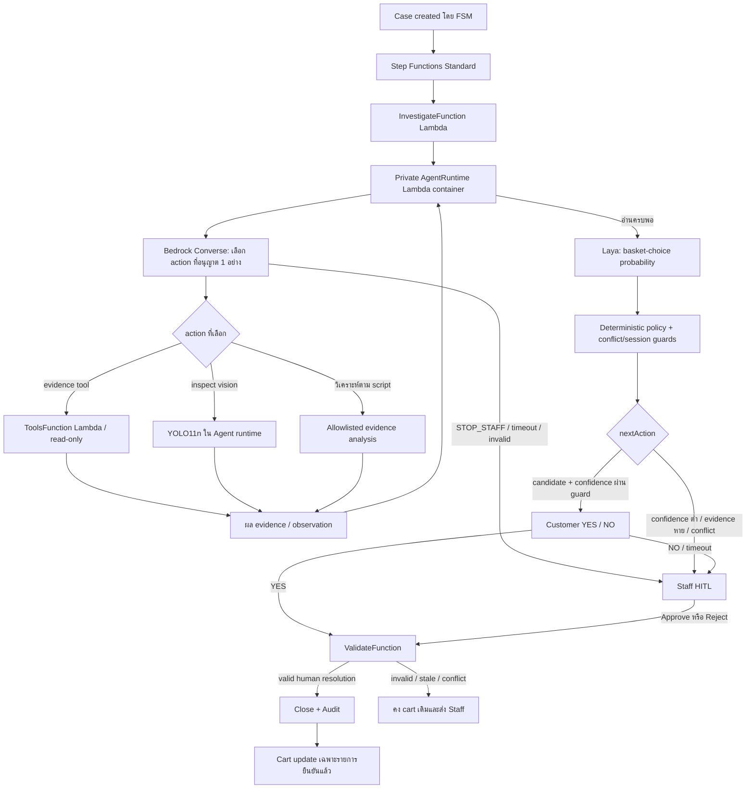
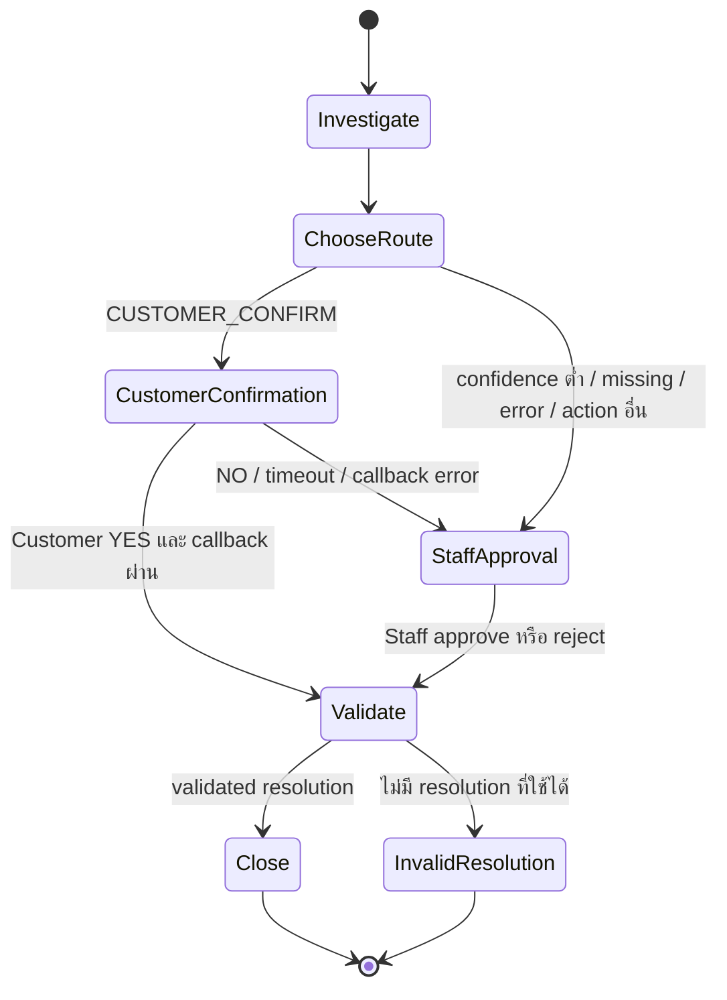
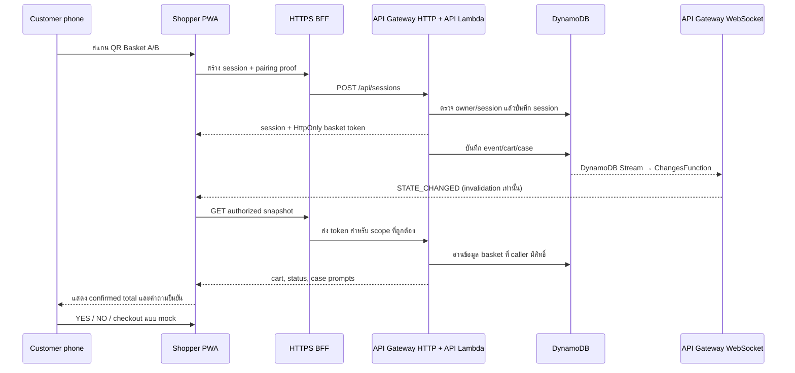
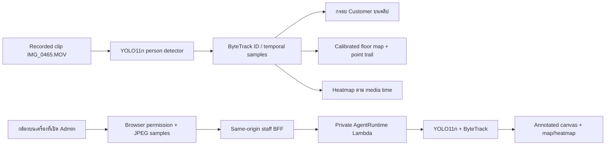
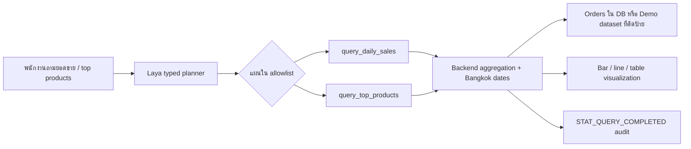
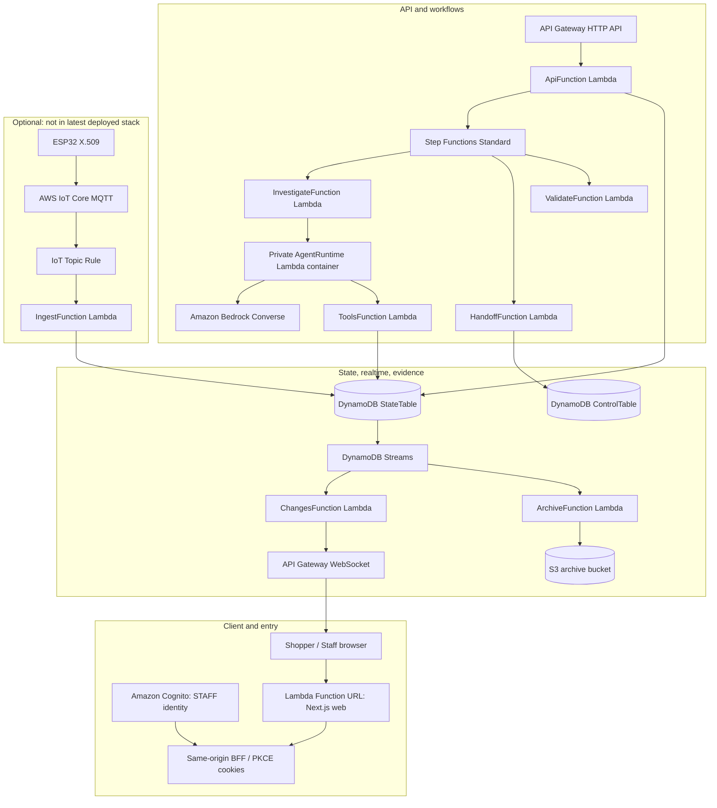
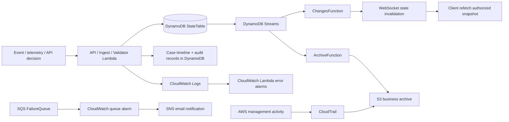
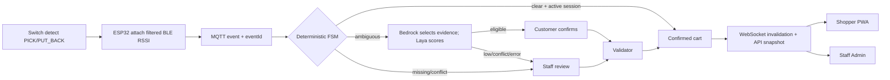

# FAST Smart Basket - Project Workflow and AWS Architecture

**เอกสารภาพรวมระบบและ workflow**
เนื้อหาเดิมเป็น snapshot วันที่ 25 ตุลาคม 2026; เพิ่มสถานะ Cloud ล่าสุด 17 พฤศจิกายน 2026 ไว้ด้านล่างและใน [cloud-deployment-status.md](cloud-deployment-status.md).

ไฟล์ PDF สำหรับนำเสนอ: [FAST project workflow](../output/pdf/fast-project-workflow.pdf).

เอกสารนี้อธิบายตั้งแต่ลูกค้าเริ่มใช้ตะกร้า การตรวจจับสินค้า การตัดสินใจของ FSM และ Agent ไปจนถึงข้อมูล, realtime, audit และ AWS services โดยแยกสถานะของโค้ดออกจากสถานะ Cloud ที่ deploy จริง

### สถานะล่าสุด 17 พ.ย. 2026

- AWS stack `fast-prototype` ใน NTT Team 14 / Singapore deploy แล้ว; IoT เปิดใช้งานและ provision credentials/policies ให้ Shelf 1–3.
- Web/Admin, Shopper, API, Agent runtime, DynamoDB, Step Functions, Bedrock, realtime, audit/archive และ monitoring resources ถูก deploy ตาม [รายงานสถานะ](cloud-deployment-status.md).
- ยังไม่มีหลักฐานใน repo สำหรับ full Cloud E2E, physical E2E ครบสามบอร์ด, measured AWS bill/latency หรือ camera accuracy. Resource status ไม่ใช่ผล acceptance.

## 1. ภาพรวมโครงการ

FAST เป็น prototype ร้านค้าขนาดเล็กที่รองรับตะกร้า 2 ใบ (Basket A/B) และ Shelf ID 3 จุด ลูกค้าสแกน QR เพื่อผูก session กับตะกร้าและดู cart ของตน พนักงานใช้ Admin เพื่อตรวจ shelf, ตรวจ Agent case, ทำ HITL และดูข้อมูลยอดขาย

กติกาควบคุมหลักมี 3 ข้อ:

1. **Deterministic FSM เป็นผู้อนุมัติการเปลี่ยน cart**: event ต้องไม่ซ้ำ, มี session ที่ตรงกัน, ผ่านกฎ RSSI/lane/quantity และผ่าน validator
2. **Agent ใช้เฉพาะเคสกำกวม**: เลือก evidence/tool ที่อนุญาตเพื่อช่วยประเมิน แต่ไม่เขียน cart เอง
3. **รายการที่ยังไม่ยืนยันไม่คิดเงิน**: `PENDING`, `CONFLICT`, เคสที่ยังเปิด หรือหลักฐานไม่พอ จะไม่รวมใน payable total; การชำระเงินจริงอยู่นอกขอบเขตและ checkout เป็น mock

### สถานะที่ใช้ในภาพรวม

| สถานะ | ความหมาย |
| --- | --- |
| **Deployed** | มีอยู่ใน Cloud stack ที่บันทึกว่า `fast-prototype` สำเร็จ |
| **Optional / prepared** | มีโค้ดและ parameter สำหรับ deploy แต่ปิดไว้ใน stack ปัจจุบัน |
| **Local** | ทำงานในเครื่องสำหรับพัฒนาและทดสอบ |
| **Pending acceptance** | โค้ด/ทรัพยากรมี แต่ยังไม่มีหลักฐานทดสอบ E2E จริงครบ |

ณ 17 พ.ย. 2026 Cloud stack มี Web, API, Agent, DynamoDB, Cognito, Step Functions, WebSocket และ operational services; `EnableIoT=true`. Thing/certificate/policy สำหรับ Shelf 1–3 ถูก provision แล้ว. การ provision ไม่ยืนยันว่า board ถูก flash หรือ physical IoT E2E ผ่าน จึงต้องแยกสถานะ resource ออกจากผลทดสอบ hardware.

## 2. ผู้ใช้, หน้าจอ และขอบเขตความรับผิดชอบ

### Shopper PWA

- สแกน QR เพื่อผูก Basket A/B และเริ่ม session
- ดูรายการที่ยืนยันแล้ว, จำนวน, ราคา, ยอดรวม และสถานะรายการที่กำลังตรวจ
- รับ state-change ผ่าน WebSocket แล้วเรียก API เพื่ออ่าน snapshot ที่ตนมีสิทธิ์เห็น
- ตอบ YES/NO เมื่อระบบเสนอให้ยืนยันรายการ; NO หรือไม่ตอบจะไป Staff
- ทำ mock checkout ได้เมื่อมีแต่รายการที่ยืนยันแล้วและไม่มี case ที่ขวาง cart

### Staff Admin

- **Monitor:** สถานะ shelf/device, RSSI, lane, event ล่าสุด, FSM state, cart และเคสเปิด
- **Agent Case Monitor:** evidence, tool calls, confidence, recommendation, next action และ timeline
- **HITL:** เลือก Basket A/B แล้ว Approve หรือ Reject; backend ตรวจสิทธิ์และเงื่อนไขซ้ำก่อนเขียน cart
- **Object Detection:** คลิปบันทึกพร้อมกรอบ/แผนที่/heatmap และกล้องของอุปกรณ์ที่เปิด Admin
- **Stat Query:** ขอ daily sales หรือ top products; Laya เลือก query/view แบบมีขอบเขต แล้ว backend aggregate ข้อมูลและ UI วาดกราฟ
- **Reset:** เครื่องมือ Admin สำหรับล้าง demo state ตาม policy ของแอป; reset Cloud ถูกปิดไว้ใน deployment ปัจจุบัน

### Shelf และสินค้า

| Shelf | ชื่อที่แสดง | Mapping ที่ตรวจพบใน backend |
| --- | --- | --- |
| Shelf 1 / `SHELF-01` | Cola | ทุก valid lane map เป็น `COKE` / Cola |
| Shelf 2 / `SHELF-02` | Sprite Plus Tea | ทุก valid lane map เป็น `SPRITE_PLUS_TEA`; เก็บ SKU ต้นทางใน audit |
| Shelf 3 / `SHELF-03` | Fanta floral bloom | ชื่อแสดงผลบนเว็บ; เอกสาร mapping ระบุว่ายังไม่ได้ยืนยัน backend product mapping |

UI รองรับ Shelf 1–3 ทั้งหมด ส่วนสถานะ **ONLINE** ต้องมาจาก telemetry ของอุปกรณ์จริง ไม่ได้เกิดจากการแสดง shelf หรือ simulator

## 3. Hardware signal → cart (Local และ Cloud)

### Hardware ที่กำหนดสำหรับ prototype

- ESP32-WROOM-32
- KW11-N/KW12 roller microswitch สำหรับ lane ที่ติดตั้ง
- iBeacon Bluetooth IP67: Basket A, Basket B และ HV-001 (tag อ้างอิง; HV-001 ไม่ใช่สินค้าใน cart)
- Firmware บน Arduino core: debounce switch, กรอง RSSI แบบ rolling median, สร้าง `eventId`, เก็บ event ใน RAM outbox และ retry จนได้ application ACK

สัญญาณที่ระบบใช้ประกอบด้วย `eventId`, `shelfId`, `laneId`, `sku`, `eventType` (`PICK`/`PUT_BACK`), เวลา, `delayed` และ `rssi.A/B` (เสริม `HV01`); telemetry แยกเป็น heartbeat, RSSI, switch state, uptime, queue depth และ dropped count

### การตัดสินใจ deterministic

1. ตรวจ schema, shelf/lane/SKU ที่อนุญาต และ `eventId`; event ID ที่เคยรับแล้วจะไม่เพิ่ม/ลด cart ซ้ำ
2. Map SKU ตาม shelf ก่อนสร้าง cart/case (Shelf 1 → Cola, Shelf 2 → Sprite Plus Tea)
3. ถ้า Basket A/B มี RSSI สดและต่างกันอย่างน้อย **10 dB** พร้อม active session ที่ตรงกัน ให้ FSM ประมวลผลโดยไม่เรียก Agent
4. ถ้าค่าต่างกันน้อยกว่า 10 dB ให้สร้าง ambiguous case; cart ยังไม่เปลี่ยนจนกว่ามนุษย์ยืนยันและ validator ผ่าน
5. RSSI หาย/เก่า, event delayed, ไม่มี active session, lane conflict หรือ PUT_BACK ไม่มีจำนวนที่ยืนยันแล้ว จะไม่เดา basket และไป Staff review
6. PUT_BACK ต้องไม่ทำให้จำนวนติดลบ; รายการ pending/conflict ไม่เข้ายอดจ่าย

ค่าระยะ 10 dB เป็นค่าเริ่มต้นสำหรับเดโม ต้อง calibrate กับตำแหน่งชั้นและ tag จริง RSSI ใช้บอกความใกล้ในโซน ไม่ยืนยันตัวบุคคลที่หยิบสินค้า

### เส้นทาง Local เทียบกับ Cloud ที่ deploy

| เส้นทาง | ปัจจุบัน |
| --- | --- |
| Local API + simulator/MQTT broker + local Laya + local JSON | ใช้พัฒนาและทดสอบ end-to-end ในเครื่อง; ports โดยทั่วไปคือ API `3000`, MQTT `1883`, Laya `8000`, YOLO `8001`, Web `3001` |
| Cloud Admin simulator → API Gateway HTTP → API Lambda | เปิดใช้กับ Staff ที่ยืนยัน Cognito; event ถูกระบุ source เป็น `SIMULATOR` |
| ESP32 → AWS IoT Core → Topic Rule → Ingest Lambda | มี source/parameter/firmware สำหรับเปิด `EnableIoT`; disabled ใน stack ล่าสุดและ physical E2E ยังรอ acceptance |
| ESP32 → local MQTT bridge → local API | local integration path; application ACK หลัง API รับ event สำเร็จ |

## 4. Agentic Case Manager และ Step Functions

Agent ใช้สำหรับ case ที่ระบบยังตัดสินไม่ได้ ไม่ได้เป็นตัวควบคุม transaction ของ cart

### ลำดับใน investigation

1. Ingest/API สร้าง event/case และบันทึก state; ถ้าเป็น unresolved case จะเริ่ม execution โดยใช้ชื่อ execution ที่ idempotent
2. Step Functions เรียก `InvestigateFunction`; clear event จะไม่เข้าสู่ Agent investigation ส่วน missing/invalid evidence ข้ามไป Staff ได้ทันที
3. AgentRuntime ใช้ **Amazon Bedrock Converse** เลือก tool/action จาก enum ที่ส่งเข้าไปในรอบนั้นเท่านั้น แล้วรัน action และอ่าน observation ก่อนเลือกครั้งต่อไป
4. Tools ใช้อ่าน evidence ที่ผูกกับ case/event ปัจจุบัน: shelf event, basket RSSI/session, cart history, telemetry window, device health, lane state, nearby events และ camera records
5. `run_evidence_analysis` เลือกเฉพาะ script ที่ allowlist เช่น `rssi_stability`, `switch_bounce`, `cart_consistency`; ไม่มี shell, SQL หรือ path ที่ model สร้างเอง
6. `inspect_vision_evidence` เรียก YOLO11n เฉพาะภาพที่ register ไว้; class/box confidence เป็นหลักฐานประกอบ ไม่ได้แปลว่าพิสูจน์ SKU, PICK/PUT_BACK หรือ ownership
7. Laya เป็น typed decision adapter ที่คืน candidate/confidence; Bedrock เป็น action selector และไม่มี calibrated ownership confidence ของตัวเอง
8. Policy บังคับ candidate/session/RSSI/quantity/conflict guards และ confidence ขั้นต่ำก่อนถามลูกค้า (เกณฑ์ customer confirmation ที่กำหนดใน domain คือ 0.75); ถ้าไม่ผ่าน ให้ Staff ตัดสิน
9. API บันทึก human decision และเรียก `SendTaskSuccess`; Validator ตรวจ case ปิดและผล resolution ก่อนปล่อย cart; decision receipt กันการทำซ้ำ

การตัดสินใจไม่ส่ง chain-of-thought ให้ UI; Admin เห็น action ที่ model เลือก, probability ของการเลือก, tools ที่มี, observation และเหตุผลที่บันทึกได้เท่านั้น สำหรับ local agentic loop เอกสารกำหนดสูงสุด 8 action และ deadline 25 วินาที; Cloud Agent Lambda มี timeout สูงสุด 300 วินาทีตาม stack แต่ต้องวัด cold-start/latency และ full case workflow บน AWS ก่อนรับรอง

### State Machine ของ Step Functions

Staff callback มีกรอบเวลาสูงสุด 24 ชั่วโมงตาม workflow; reconciler ทำงานทุกนาทีเพื่อตรวจ workflow/callback ที่ค้างและเริ่มต่อเมื่อจำเป็น ไม่มีการอนุมัติ cart อัตโนมัติเมื่อ timeout หรือ workflow fail

## 5. Shopper, Staff และ realtime flow

WebSocket ส่งเพียงข้อความ invalidation ไม่ส่ง cart ทั้งก้อน; browser ดึง authorized snapshot ผ่าน API อีกครั้ง ข้อมูล A/B, audit และ Agent evidence ถูก scope ตามสิทธิ์ ผู้ใช้ไม่มี AWS credentials ใน browser

### การยืนยันตัวตนและสิทธิ์

- Staff เข้าหน้า FAST `/admin/login` แล้ว BFF เริ่ม Cognito Authorization Code + PKCE; Cognito group `STAFF` เป็นสิทธิ์เข้าถึง dashboard/admin APIs
- BFF เก็บ access token ใน `HttpOnly`, `Secure` cookie และ backend ตรวจ issuer/client/token use/group อีกชั้น
- Shopper เริ่ม session ผ่าน QR pairing และได้รับ token ที่ผูก basket/session; shopper อ่านหรือ checkout ได้เฉพาะ basket ที่เป็นเจ้าของ
- WebSocket ใช้ single-use ticket อายุสั้นใน handshake; task token ของ Step Functions ไม่ส่งไป browser

## 6. Admin: Object Detection และ Stat Query

### Video, camera, map และ heatmap

- Recorded mode ใช้ clip ที่ให้มา; class `person` แสดงเป็น `Customer`, ใช้ ByteTrack และ map/heatmap sync กับ media time
- Basket A/B ที่กำหนดให้ track เป็น manual assignment จากเจ้าของ requirement ไม่ใช่การรู้จำใบหน้าหรือการคำนวณจาก BLE
- Live mode เปิดกล้องของเครื่องที่เปิด Admin ผ่าน browser permission/HTTPS แล้วส่ง JPEG ที่ลดขนาดผ่าน BFF ไป YOLO; ปัจจุบันไม่ใช่ RTSP integration
- Calibrate ด้วย 4 จุดของพื้นและจุดกึ่งกลาง footprint ของ Shelf 1–3; กล้องขยับ/เปลี่ยน zoom ต้อง calibrate ใหม่
- ภาพ live ไม่ถูกเก็บใน cart, database หรือ audit; detection เป็นข้อมูล visual analytics ไม่เปลี่ยน cart และไม่ตัดสินว่าใครหยิบสินค้า

### Stat Query Chat

Planner เลือก field เช่น query, metric, chart จาก typed choices; application ตรวจ plan, วัน/ช่วงเวลา, Top-N และความสอดคล้องกับข้อความก่อน aggregate ข้อมูล Orders ใช้ completed mock checkout เท่านั้น; pending cart/case ไม่รวม ไม่ส่ง row/customer/session ให้ Laya และไม่มี SQL/code ที่ model สร้างหรือเขียน DB

## 7. AWS architecture และหน้าที่ของแต่ละ service

### AWS service inventory

| Service / resource | ใช้ทำอะไร | สถานะตาม deployment record ล่าสุด |
| --- | --- | --- |
| AWS Lambda Function URL | HTTPS entry สำหรับ Next.js container (Shopper/Admin) | Deployed; Web Lambda Active |
| Amazon ECR | เก็บ Web/Agent container image; scan on push และ immutable tags | Deployed |
| Amazon Cognito User Pool/Client/STAFF | Staff login, OAuth code flow + PKCE identity | Deployed; demo staff user provisioned |
| API Gateway HTTP API | HTTP endpoint จาก BFF ไป API Lambda | Deployed |
| AWS Lambda `ApiFunction` | REST routes, auth, sessions/cart, simulator, case decisions, query orchestration | Deployed |
| API Gateway WebSocket API | Realtime connection สำหรับ state invalidation | Deployed |
| AWS Lambda `WebSocketFunction` | ตรวจ single-use ticket บน connect และลบ connection ตอน disconnect | Deployed |
| DynamoDB `StateTable` | Encrypted business records: sessions, carts, events, cases, orders, telemetry, receipts, audit/meta; stream + PITR | Deployed |
| DynamoDB `ControlTable` | WebSocket tickets/connections, HITL task tokens/decisions, TTL cleanup | Deployed |
| AWS Secrets Manager | Session signing / QR pairing secret; ไม่ส่ง secret ให้ browser | Deployed |
| AWS Step Functions Standard | Orchestrate investigation, customer/staff wait, validation และ close | Deployed; full AWS case acceptance ยังรอ |
| AWS Lambda `InvestigateFunction` | Step Functions entry ไป private Agent runtime | Deployed |
| AWS Lambda `AgentRuntime` container | Private Node runtime, Laya, YOLO และ Bedrock tool-selection loop | Deployed; health/readiness ผ่าน, full case E2E รอ |
| Amazon Bedrock Converse | เลือก action/tool แบบ constrained จาก action enum | Invoke readiness ผ่านด้วย `apac.amazon.nova-lite-v1:0`; full live case acceptance ยังรอ |
| AWS Lambda `ToolsFunction` | เรียก read-only case evidence tools แบบจำกัด ARN/arguments | Deployed |
| AWS Lambda `HandoffFunction` | บันทึก/ส่ง customer หรือ staff task-token callback | Deployed |
| AWS Lambda `ValidateFunction` | ตรวจว่ามี recorded human resolution ก่อน close/cart effect | Deployed |
| AWS Lambda `ReconcileFunction` | ทำงานทุกนาทีเพื่อตรวจ workflow/callback ที่ยังไม่ launch/resume | Deployed |
| AWS Lambda `IngestFunction` + IoT Topic Rule | รับ event/telemetry จาก IoT, map/FSM, persist แล้ว ACK device | Deployed; `EnableIoT=true`; 3 Thing/cert/policy provisioned, per-board E2E pending |
| AWS Lambda `ChangesFunction` | อ่าน DDB stream changes แล้วส่ง realtime invalidation | Deployed; transient WS error handling ปรับแล้ว |
| AWS Lambda `ArchiveFunction` + S3 | Archive event/case/order/audit record จาก stream; S3 private, SSE-S3, versioned, 90-day lifecycle | Deployed |
| Amazon CloudWatch Logs | Application/Lambda logs; retention 14 วัน | Deployed |
| CloudWatch alarms + SQS FailureQueue + SNS | แจ้งเมื่อ Lambda error หรือ FailureQueue มีข้อความ | Deployed; current alarm/queue depth ไม่ได้ตรวจใน snapshot 17 พ.ย. |
| AWS CloudTrail | Management API activity trail และ log file validation | Deployed |
| AWS Budgets | Email alert เมื่อค่าใช้จ่ายจริงเกิน 80% ของงบรายเดือน US$50 | Deployed; เป็น alert ไม่ใช่ hard spending cap |

AWS Lambda Web Adapter ทำหน้าที่เป็น adapter ให้ Next.js/Agent container รับ Lambda invocation; ไม่ใช่ AWS application service แยกต่างหาก ส่วน YOLO และ Laya เป็น model/runtime ที่อยู่ใน Agent container ไม่ใช่ managed AWS AI endpoint

### Data, realtime และ audit

Business audit เก็บ case timeline และ action เช่น event, evidence/tool result, model proposal, customer/staff decision, validation และ cart/order update ใน state records; CloudWatch ใช้ application logs/alarms; CloudTrail เก็บ AWS management activity; S3 เป็น archive แยกจาก live state

## 8. ตัวอย่าง business flows

| Scenario | เส้นทาง | ผลกับ cart |
| --- | --- | --- |
| Clear PICK / Basket A เด่นกว่าอย่างน้อย 10 dB | Event → validation/dedupe → SKU mapping → deterministic FSM → validator | เพิ่มรายการยืนยันโดยไม่เรียก Agent |
| Ambiguous PICK | Event → case → Step Functions → Bedrock เลือก evidence tools → Laya/policy → Customer YES/NO | ระหว่างรอไม่เพิ่มยอด; YES และผ่าน validator จึงเพิ่ม, NO/timeout ส่ง Staff |
| Low confidence / tag หาย / event delayed / conflict | Deterministic quarantine หรือ Agent escalation → Staff case monitor → Approve/Reject → validator | ยอดไม่เปลี่ยนจน Staff ตัดสินและ validation ผ่าน |
| PUT_BACK | Event → same mapping and guards; ตรวจว่ามี quantity confirmed | ลบได้เฉพาะจำนวนที่มี; ป้องกัน quantity ติดลบ; conflict ไป Staff |
| Duplicate delivery / sensor bounce | Event ID idempotency และ firmware debounce | ไม่เพิ่ม/ลดซ้ำ; duplicate ถูก audit แล้ว ignore |
| Object detection | Recorded replay หรือ live camera → YOLO/ByteTrack → overlay/map/heatmap | เป็น analytics; ไม่ mutate cart |
| Stat Query | พนักงานถาม → Laya typed plan → allowlisted backend aggregate → graph/table + audit | อ่านข้อมูลเท่านั้น; ไม่เปลี่ยน cart/order |

## 9. สถานะ deployment, ข้อจำกัด และงานคงเหลือ

### Historical Cloud snapshot — 25 ต.ค. 2026

- CloudFormation stack `fast-prototype` เป็น `UPDATE_COMPLETE`; Web/Agent Lambda เป็น `Active` / `Successful`
- Web Function URL, API Gateway HTTP/WebSocket, Cognito, DynamoDB, Step Functions และ S3 archive สร้างแล้ว
- Bedrock readiness เรียกจริงผ่าน Converse ด้วย model `apac.amazon.nova-lite-v1:0`; นี่เป็น readiness/tool-selection check ไม่ใช่ผลพิสูจน์ full Agent investigation
- Admin/Shopper เคยเข้าสู่ระบบ/โหลด state ได้ผ่าน deployed app
- ตอน snapshot วันที่ 25 ต.ค. `EnableIoT=false`; สิ่งนี้ถูกแทนที่ใน update วันที่ 17 พ.ย. ด้วย IoT resources และ provisioning สำหรับสาม shelf.
- Camera mode ใช้กล้องของเครื่องที่เปิด Admin ผ่าน browser/HTTPS; RTSP capture ยังไม่ implement
- Recorded customer map/heatmap ใช้ YOLO11n + ByteTrack และ calibration จากคลิปที่มี; map ไม่ยืนยัน identity/ownership
- Checkout เป็น mock payment; ไม่มี POS/ERP, real payment, membership/coupon หรือ multi-store
- Cloud full case path (Agent + Step Functions callbacks + validator), Shopper QR, camera inference, latency/cost และ physical acceptance ยังต้องทดสอบบน AWS ก่อนเรียกว่า production-ready

### Alarm/backlog snapshot เก่า (ไม่ใช่ current queue count)

ข้อมูลด้านล่างมาจาก CloudWatch read ครั้งก่อนการ reset/deploy รอบใหม่ จึงไม่ใช่สถานะปัจจุบันและห้ามใช้อ้างจำนวนข้อความค้างวันนี้:

- `ChangesFunction` transient WebSocket/DNS failures ได้แก้แล้ว; Lambda error alarm เป็น OK และ stream mapping เป็น OK
- ย้ายเฉพาะ failure messages ของ `ChangesFunction` 31 รายการไป S3 archive และลบจาก FailureQueue ตาม approval
- FailureQueue เคยเหลือ **1,405 historical IngestFunction messages**; ตัวเลขนี้เป็นข้อมูลใน snapshot เดิมเท่านั้น ไม่ได้ตรวจคิวซ้ำใน deployment วันที่ 17 พ.ย.

### ขอบเขตความเชื่อมั่น

| ระบบ | ทำได้ | ยังไม่ควรอ้างว่า |
| --- | --- | --- |
| BLE RSSI | ใกล้กว่า/สัญญาณในโซน | พิสูจน์ตัวคนหรือยืนยันผู้หยิบ |
| YOLO11n COCO | ตรวจ `person`/กรอบ object ตาม class ที่โมเดลรู้จัก | ตรวจ SKU/ทิศทาง pick-return/ownership โดยไม่มี detector และหลักฐานที่ calibrate |
| Bedrock | เลือกจาก tool/action ที่อนุญาต | มี confidence ownership ที่ calibrate หรือแก้ cart โดยตรง |
| Laya | คืน typed candidate/probability ตาม contract | ความแม่น retail ที่รับรองแล้ว |
| Local E2E | ทดสอบ MQTT/bridge/FSM/Agent/HITL/cart/audit ผ่าน software harness | ยืนยัน AWS IoT/Cloud callbacks/physical hardware ทุก shelf |
| Cloud deploy | ยืนยัน resources และ readiness บางเส้นทาง | ระบบผ่าน full production acceptance |

## 10. แผนภาพย่อสำหรับการนำเสนอ

> **กฎสรุป:** hardware/Agent สร้าง evidence และ recommendation; deterministic FSM + human decision + validator เป็น gate ก่อน item เข้าสู่ payable cart

## 11. เอกสารอ้างอิงภายใน

- [Project README](../README.md) - local stack, scope, commands และ system map
- [Cloud deployment kit](../infra/cloud/README.md) - deploy parameters, AWS components, security/recovery boundaries
- [Cloud deployment status](cloud-deployment-status.md) - บัญชี/Region, services ที่ deployed และ acceptance คงเหลือ
- [Agentic investigation](agentic-investigation.md) - tool catalog, decision loop และ local verification boundary
- [Event contract](event-contract.md) - event schema, decision rules, ACK และ telemetry
- [IoT roadmap](iot-roadmap.md) - hardware wiring, BLE/beacon, firmware/outbox และ acceptance tests
- [Shelf product mapping](shelf-product-mapping.md) - product mapping ตาม shelf ปัจจุบัน
- [Customer detection](customer-detection.md) และ [Admin camera controls](admin-controls-camera.md) - recorded/live video, map calibration และ limits
- [Stat Query](stat-query.md) - typed planner, allowlisted aggregates และ chart behavior
- [FAST tech answers](2026-10-25-FAST_FINAL_Questions_for_Tech_Hardware_Answers.md) - ขอบเขตระบบ/IoT ที่ตรวจล่าสุด
