# Local system integration — 22 October 2026 (Asia/Bangkok)

Integrated inputs: `main` at `f3f7d5d` (reviewed ESP32 hardware + backend) and `feature/web-app` at `44b5222` (Next.js Shopper/Staff). The root backend remains the single source of truth. No production AWS resources were changed.

```mermaid
flowchart LR
  Signal[Mock ESP32 switch / BLE payload] --> MQTT[Hardware local MQTT broker]
  MQTT --> Compute[HTTP ingestion / deterministic FSM]
  Compute -->|clear event| Cart[Confirmed cart]
  Compute -->|ambiguous| Tools[Three evidence tools]
  Tools --> Laya[Actual local Laya CPU model]
  Laya --> Policy[Deterministic policy]
  Policy --> HITL[Customer or Staff decision]
  HITL --> Validator[Cart validation]
  Validator --> Cart
  Compute --> DB[Local JSON repository / audit]
  Cart --> DB
  DB --> SSE[HTTP snapshot / native SSE]
  SSE --> Proxy[Next.js development API proxy]
  Proxy --> Web[Shopper A / Shopper B / Staff]
  Compute -->|success after persistence| ACK[Application ACK to mock device]
```



## Integration changes

- Merged the existing Next.js application, preserving its QR pairing, sessions, confirmed totals, customer confirmation, Staff approval/rejection, checkout/receipts, responsive layouts, realtime recovery and explicit mock login.
- Updated API types for Agent metadata, delayed device events and the optional HV01 reference beacon. HV01 never replaces a missing basket identity.
- Admin now shows actual Agent provider/status/model/latency, evidence-tool summaries and a persisted audit panel. Human actions are unavailable while inference is running; the backend independently enforces the same restriction.
- Simulator event requests allow 35 seconds for the backend's 30-second model deadline. Other requests retain their 12-second timeout; uncertain mutations are not automatically retried.
- Updated the isolated browser test API helper to use the current application/repository modules. Customer YES/NO UI tests explicitly select the MOCK provider. The system test explicitly selects LAYA.

## Verified locally

| Check | Result |
| --- | --- |
| Root `npm test` | 33/33 passed: FSM, idempotency, cart/session guards, provider contracts/failures, persistence, Lambda contracts and bridge ACK rules |
| Native C++ firmware checks | Protocol/outbox and switch-debounce suites passed; firmware source was not changed in this integration |
| `web`: lint, typecheck, build | All passed, including the final display/type changes |
| `web`: `npm run test:e2e` | All four browser suites passed: mock auth, Shopper, Admin, native realtime |
| Production mock-auth guard | Disabled-mode browser suite passed; forged mock storage cannot mount Admin or subscribe to API/SSE |
| `npm run verify:hardware` | 19/19 passed through the actual Hardware broker/HTTP forwarder with HV01 payloads and actual Laya |
| `npm run verify:full-flow` | 19/19 passed through the production IoT bridge code using local MQTT and actual Laya |
| `web`: `npm run test:system` | Passed with real Chromium, Next.js same-origin proxy/native SSE, actual Hardware broker, backend/FSM, Laya, JSON persistence, audit and mock checkout |
| Runtime dependency audit | `npm audit --omit=dev`: zero findings at verification time |

Each backend full-flow run exercised 30 PICK/PUT_BACK cycles plus 30 duplicate deliveries, both baskets/SKUs, ambiguous PICK/PUT_BACK, missing BLE, delayed signals, empty-cart returns, model HTTP 503 and actual 30-second timeout, slow inference with device retry, malformed messages, MQTT reconnect, application restart, checkout and the local Lambda tool/validator/audit chain.

The additional browser system run independently completed **30 cycles, 60 cart transitions and 30 duplicate retransmissions**. Its total **99 MQTT deliveries** also included three actual Laya investigations, three subsequent returns, missing-tag and delayed signals, and a final checkout item. It asserted no unconfirmed charge, no extra quantity on duplicate delivery, no staff decision during inference, matching persisted cart/order/audit, receipt after reload and no browser runtime errors. No browser API responses were intercepted in that run.

The first cold mock-auth suite attempt timed out during a repeated login. An isolated auth rerun and the subsequent complete four-suite run passed. This transient was not counted as a passing run.

### Retained local evidence (ignored by Git)

- `data/full-flow-HYhbnG/report.json`: Hardware broker path.
- `data/full-flow-CGuNYt/report.json`: production IoT bridge path.
- `data/web-system-1792610662440/report.json`: browser + MQTT + real-model system run, with broker/frontend logs and mobile screenshots alongside it.
- `data/web-ui-checks/`: browser screenshots covering login, cart, confirmation, staff review, receipt, scanner, responsive/error/disconnected states.
- `data/web-npm-audit.json` and `data/web-runtime-audit.json`: dependency audit snapshots.

## Run the integrated demo

From the repository root, install dependencies with `npm ci`, then in separate terminals:

```powershell
npm run model:laya
npm start
npm run broker
```

In `web/`:

```powershell
npm ci
npm run dev:mock
```

Open `http://127.0.0.1:3001/shopper?basket=A`, a second tab with `basket=B`, and `/admin`. Staff login uses the fictional account displayed on the local login form. Publish mock device events to `smartbasket/shelf/SHELF-01/events` on MQTT port 1883, or use Admin's Local simulator for HTTP-only demonstrations.

For repeatable browser/MQTT verification, stop the demo Next.js dev server in this checkout, keep Laya running, then execute `npm run test:system` in `web/`. It starts and stops its own isolated services and never resets the team's demo database.

## Remaining boundaries

- Physical ESP32/switch/BLE signals, shelf calibration and Wi-Fi behavior still require real hardware integration. Firmware compilation was verified in the preceding Hardware review; this change reran native protocol/debounce tests.
- AWS IoT Core TLS, deployed Lambda, live DynamoDB, Step Functions callbacks, Bedrock orchestration, Cognito and cloud hosting were not exercised or deployed. Local Lambda code/SDK contracts are not evidence of live AWS integration.
- Real Laya returned `NONE` for all three browser system scenarios; all correctly required Staff HITL. Real-model customer confirmation was not reached. Customer YES/NO is covered separately by explicit fixtures, and model attribution accuracy is not established.
- Local API access remains unauthenticated. Mock login is only a development UI simulation; production Admin remains disabled. The Next.js API proxy remains development-only.
- MQTT telemetry is logged; device heartbeat/offline inference is not wired to the dashboard. Displayed shelf status remains backend-reported.
- Dependency audit reported nine high findings in development tooling (the braces/glob dependency chain used by shadcn and ESLint). Runtime dependencies had zero findings. No forced major dependency downgrade was applied.
- Checkout is a mock payment. Audit retention and case/event snapshot limits remain those of the existing prototype.
