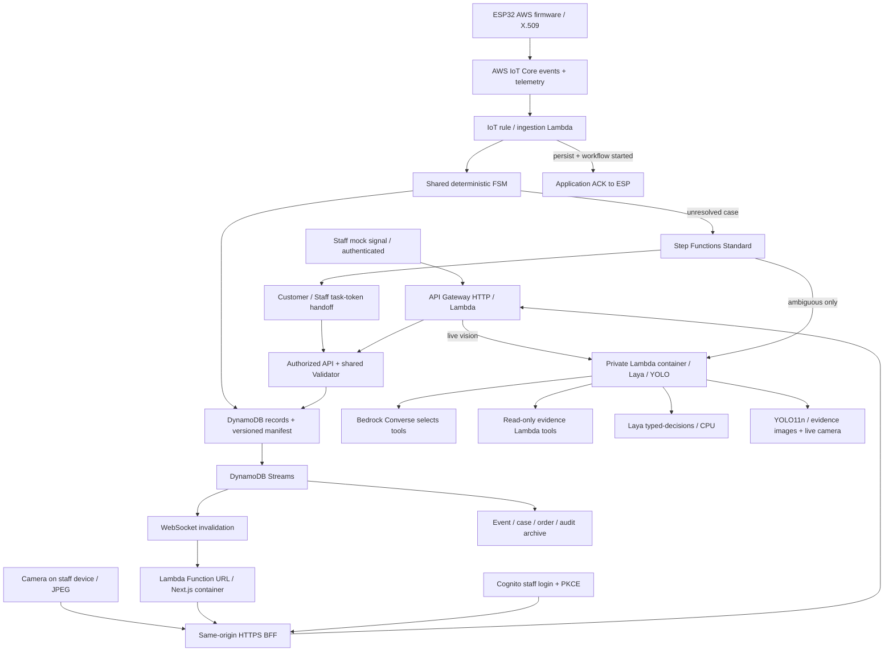

# Cloud deployment kit

ชุดนี้เตรียมระบบสำหรับ **FAST prototype สาม shelf / สอง basket** โดยใช้ domain/FSM เดียวกับ local ค่าเริ่มต้น deploy โดย **ไม่สร้าง IoT resources** และใช้ mock signal จาก Staff Dashboard ไม่มีคำสั่ง deploy ที่รันอัตโนมัติจากการเปิด repo หรือ `npm test`

## Runtime



Lambda container เป็น runtime ของ agent; Bedrock Converse เลือก action จริงจาก tools/scripts ที่อนุญาต ส่วน Laya ให้ basket-choice probability และ policy เดิมยังบังคับยืนยันก่อนเปลี่ยน cart ผู้ใช้ Stat Query เรียก Laya ภายใน runtime เดียวกัน Evidence ของ case ใช้ registered frames ส่วนกล้องสดส่ง JPEG ผ่าน Staff BFF ไป YOLO โดยไม่เก็บภาพใน DB หรือ audit log

เส้น ESP/IoT ใน diagram ใช้เมื่อเปิด `enableIoT` เท่านั้น เมื่อเปิดจะรับ `SHELF-01` ถึง `SHELF-03` ผ่าน topic rule เดียว โดยแต่ละบอร์ดใช้ client ID และ X.509 certificate แยกกัน ปุ่ม simulator บันทึกแหล่งที่มาเป็น `SIMULATOR` และไม่สร้าง device telemetry หรือทำให้ shelf แสดง ONLINE

Agent image รวม Node agent และ Python model services สอง environment ไว้ด้วยกัน ใช้ AWS Lambda Web Adapter 1.1.0 และบริการโมเดลฟังเฉพาะ loopback ภายใน container โมเดลและภาพตัวอย่างดาวน์โหลด/ตรวจ hash ตอน build ใช้ Hugging Face cache เดียวกันและเปิด offline mode ตอน runtime จึงไม่ดาวน์โหลด weights ซ้ำตอนเริ่มระบบ Agent ไม่มี Function URL; API/Investigate Lambda เรียกผ่าน `lambda:InvokeFunction` ที่จำกัด ARN เท่านั้น Browser ไม่ได้รับ AWS credentials หรือ model endpoint

## สิ่งที่สร้างเมื่อสั่ง deploy

- ECR สอง repository และ image tags แบบ immutable
- Lambda container สำหรับ Next.js (2 GB) + public HTTPS Function URL, API Gateway HTTP/WebSocket, Cognito User Pool + STAFF group
- DynamoDB StateTable แยก case/event/order/audit/telemetry เป็น records พร้อม optimistic transaction; ControlTable สำหรับ single-use tickets และ task tokens
- IoT Thing, restricted device policy, IoT rule และ ingestion/ACK เฉพาะเมื่อ `enableIoT: true`
- Private Agent Lambda container (amd64 / 3,008 MB / timeout 300 วินาที) + Bedrock model permissions, evidence Lambda, Step Functions และ Customer/Staff callbacks
- DynamoDB Streams realtime fanout และ S3 archive
- CloudWatch Lambda logs 14 วัน, error alarms + SNS, monthly budget notification และ CloudTrail management trail

Budget เป็น **account-level alert** ไม่ใช่ spending cap ค่า Lambda/Bedrock/ECR/CloudTrail และบริการอื่นเกิดขึ้นเมื่อ deploy/ใช้งาน ตรวจบัญชีและงบก่อนรัน deploy script

## เตรียมเครื่องและ config

ต้องมี Node.js 22+, AWS CLI v2, AWS SAM CLI, Docker Desktop Linux Engine และ AWS identity ที่ provision services เหล่านี้ได้ ใช้ IAM Identity Center/SSO หรือ role ที่ได้รับอนุญาต ไม่มี access key ฝังใน repo

เมื่อใช้ assumed role สคริปต์อ่าน `iam:GetRole` และจำลอง `iam:PassRole` ด้วย `iam:SimulatePrincipalPolicy` ก่อนสร้าง resources เพื่อหยุดตั้งแต่ต้นหากส่ง execution role ให้ Lambda ไม่ได้ ผล simulation ไม่ครอบคลุม SCP หรือ service quotas ทั้งหมด แนวทางปัจจุบันใช้ ChallengerAccess ของ NTT เดิม โดยไม่ได้แก้ IAM permission set

```powershell
npm ci
npm --prefix web ci
New-Item -ItemType Directory -Force data | Out-Null
Copy-Item infra/cloud/config.example.json data/cloud-config.json
```

แก้ `data/cloud-config.json`:

| ค่า | ต้องใส่อะไร |
| --- | --- |
| `stackName`, `region`, `profile` | ชื่อ stack ตัวพิมพ์เล็ก 3–30 ตัวอักษร, region ที่ใช้บริการครบ และ AWS CLI profile |
| `accountId` | AWS account ID 12 หลัก ต้องตรงกับ STS identity ก่อนสร้าง resources |
| `imageTag` | tag ใหม่ทุก release เช่น commit SHA; ห้ามใช้ tag เดิมเพราะ ECR immutable |
| `bedrockModelId` | model หรือ inference profile ที่บัญชี/region ใช้ได้และรองรับ Converse tool use |
| `bedrockInvokeResources` | ARN ของ model/profile ทั้งหมดที่ต้อง invoke; script ไม่รับ wildcard |
| `budgetEmail`, `monthlyBudgetUsd` | ผู้รับแจ้งเตือนและวงเงินแจ้งเตือนรายเดือน |
| `shelfId` | `SHELF-01` สำหรับ Thing เดิม; IoT ingestion รองรับ shelf ID ทั้งสาม |
| `enableIoT` | `false` ใน config ตัวอย่าง; `true` สร้าง ingestion, Thing, policy และ rule สำหรับทั้งสาม shelf |
| `enableDemoSignals` | `true` เปิด mock signal เฉพาะผู้ใช้ Cognito group `STAFF`; ปิดได้หลังต่ออุปกรณ์จริง |

การมีชื่อ model ใน config ไม่ยืนยันสิทธิ์ใช้งาน ต้องตรวจ model access, region และ inference-profile permissions ในบัญชีจริงก่อน deploy ไม่มี paid model ถูกเรียกโดยการทดสอบ offline

## ตรวจโดยไม่ deploy

```powershell
npm run cloud:prepare
npm test
npm --prefix web run test:cloud
npm --prefix web run typecheck
npm --prefix web run lint
```

`cloud:prepare` สร้าง SAM JSON และ Lambda source staging จาก allowlist `src/` + package files เท่านั้น ไม่ pack `.worktrees`, data, firmware secrets หรือ certificates `template.mjs` เป็น source ของ `template.json`/`bootstrap.json`; แก้ source แล้ว generate ใหม่

ถ้ามี cfn-lint:

```powershell
cfn-lint infra/cloud/template.json infra/cloud/bootstrap.json
```

`test:cloud` build production Next ลง `.next-cloud` และใช้ temporary HTTPS identity/AWS fixtures กับ native WSS โดยไม่แตะ API/DB ที่เปิด demo อยู่ ต้องมี OpenSSL; Windows ใช้ตัวที่มากับ Git for Windows ได้ การตรวจนี้ไม่ใช่ผลทดสอบ AWS จริง

ตรวจ image ภายในเครื่อง:

```powershell
docker buildx build --platform linux/amd64 --provenance=false --load -f infra/cloud/Web.Dockerfile -t basketly-cloud-web:check .
docker buildx build --platform linux/amd64 --provenance=false --load -f infra/cloud/Agent.Dockerfile -t basketly-cloud-agent:check .
npm run cloud:images
```

ครั้งแรกดาวน์โหลด dependencies/model ประมาณหลาย GB รอบ Lambda build ทั้งสอง image เป็น amd64 ส่วนผล ARM64/x64 emulation ในประวัติด้านล่างเป็นของแนวทาง AgentCore เดิม ใช้ report ยืนยันเฉพาะสิ่งที่ตรวจจริง ไม่ถือเป็น latency บน AWS

`cloud:images` เปิด containers ชั่วคราวด้วยพอร์ต localhost ที่ระบบจัดให้ ตรวจ production web/PKCE/CSRF, model readiness, YOLO inference บนภาพ MOCK และ Laya ผ่าน HTTP `STAT_PLAN` contract แล้วลบเฉพาะ containers ของการตรวจนี้ บันทึกผลใน `data/cloud-images-*/report.json` ไม่ส่ง AWS credentials เข้า container และไม่เรียก Bedrock/DynamoDB จริง

## Deploy เมื่อพร้อมใช้บัญชีจริง

```powershell
aws sso login --profile YOUR_PROFILE
aws sts get-caller-identity --profile YOUR_PROFILE
powershell -NoProfile -File scripts/deploy-cloud.ps1 -ConfigPath data/cloud-config.json
```

คำสั่งสุดท้ายสร้าง resources ที่มีค่าใช้จ่าย: deploy ECR bootstrap, build/push images, SAM build แพ็กเกจ ZIP ร่วมครั้งเดียวสำหรับ handlers, deploy และ update callback URL เป็น HTTPS Function URL รอบที่สอง ใช้ build directory ชื่อสั้นแยกแต่ละรอบเพื่อหลีกเลี่ยง file lock/MAX_PATH บน Windows เก็บ outputs ใน ignored `data/cloud-outputs.json` ไม่มีรหัสผ่าน/keys ใน outputs

หลัง deploy:

1. ยืนยัน SNS subscription ทาง email แล้วรัน `.\.venv-cloud\Scripts\python.exe scripts/set-cloud-staff-password.py --email YOUR_EMAIL` ใน terminal ของตัวเองเพื่อสร้าง/ตั้งบัญชี Cognito และ group `STAFF` สคริปต์ตรวจ AWS account และถามรหัสผ่านแบบไม่แสดงตัวอักษร ไม่ใส่รหัสผ่านใน arguments, ไฟล์ หรือ Git (เลือกทำผ่าน Cognito console เองได้เช่นกัน)
2. รัน `node scripts/check-cloud-web.mjs` เพื่อตรวจ public isolation, production routing, PKCE redirect และ CSRF; ไม่ trigger checkout, hardware หรือ model inference
3. รัน `node scripts/cloud-pairing.mjs` เพื่อสร้าง URL และ SVG QR สองใบใน `data/` แบบ offline รหัส QR เป็นสิทธิ์เริ่ม session ของ basket จึงแจกเฉพาะตะกร้า demo
4. ก่อนซ้อมรัน `.\.venv-cloud\Scripts\python.exe scripts/warm-cloud-agent.py` เพื่อ warm Laya/YOLO ผ่าน private Lambda health route โดยไม่แตะ cart/case (cold start ที่วัดได้ประมาณ 176 วินาที) คำสั่งนี้ไม่ยืนยันสิทธิ์ Bedrock
5. เปิด HTTPS Shopper ด้วย QR และ Staff login ใช้ simulator ใน Admin เพื่อส่ง PICK/PUT_BACK โดยยังไม่ต่อ ESP และเปิดกล้องบนอุปกรณ์ที่ใช้ Admin ได้จาก “กล้องสด”
6. เมื่อเปิด IoT แล้ว provision แยกทีละบอร์ดด้วย `powershell -NoProfile -File scripts/provision-cloud-device.ps1 -ShelfId SHELF-01` (เปลี่ยน ID เป็น `SHELF-02` หรือ `SHELF-03`); private key และ header อยู่ใน ignored `data/aws-device/`
7. Compile/flash sketch ที่ตรงกับ shelf: `aws_shelf`, `aws_shelf_02` หรือ `aws_shelf_03`; Shelf 3 ใช้ GPIO 18/21 ตาม wiring ของบอร์ดนั้น

## Guarantees และการ recover

- Device ACK หลัง persist และเริ่ม workflow ของ unresolved case สำเร็จเท่านั้น ใช้ execution name เดิมเมื่อ retry และมี durable event receipts เพิ่มจาก bounded local duplicate cache
- Clear events ไม่เรียก Bedrock ส่วน missing-tag/invalid evidence เข้า Staff flow โดยตรง
- Bedrock เลือก action enum ที่มีจริงเท่านั้น ไม่สร้าง ownership confidence จากข้อความ การตอบผิด schema/timeout/escalation ไม่เพิ่ม cart
- Customer YES/NO และ Staff decision ต้องมีสิทธิ์ + active task-token handoff ก่อนเขียน cart มี decision receipt ใน transaction เดียวกับ cart ทำให้ retry ไม่ charge ซ้ำ Reconciler ทุกนาทีส่ง callback ที่ค้างและเริ่ม workflow ที่ยังไม่ launch
- Customer NO, timeout หรือ validation conflict ไป Staff; task token ไม่ถูกส่งให้ browser หรือใส่ snapshot
- Shopper token ลง HttpOnly/Secure cookie และผูก basket/session; ผู้ใช้ไม่เห็น cart, orders, audit หรือ agent evidence ของคนอื่น Staff ใช้ Cognito access JWT ที่ verify issuer/client/token-use/group ที่ backend
- QR pairing retry จากแท็บเดิมใช้ random attempt ID เพื่อรับ session เดิมเมื่อ response แรกขาดหาย session ที่ยัง active ไม่ให้ลูกค้าคนอื่น claim พนักงานกด **คืน Basket A/B** ได้เฉพาะ cart ว่างและไม่มีเคสค้าง
- WebSocket ใช้ single-use ticket อายุ 60 วินาที และ browser renew connection ก่อนสิทธิ์หมดอายุ ข้อความมีแค่ invalidation; browser ดึง authorized snapshot เอง จึงไม่ส่ง state ใหญ่/ข้อมูลส่วนตัวผ่าน query string หรือ frame เดียว
- Cloud hardware Offline ใช้ receipt time + expiry timer ฝั่งเว็บแล้วดึง server state; ไม่ต้องรอ EventBridge ซึ่งละเอียดระดับนาที Local ยังใช้ SSE/timer เดิม

## ขอบเขต prototype

- DB cloud เริ่มใหม่ ไม่ย้าย/ล้าง demo JSON ในเครื่องอัตโนมัติ ตั้งใจใช้ stack แยกสำหรับการซ้อม
- Records แยกแล้ว แต่ยังมี ordered manifest และโหลด compact store เพื่อ reuse deterministic domain: record/manifest จำกัด 240 KB, transaction ไม่เกิน 100 actions/3.5 MB ถ้าถึงขีดจำกัดจะหยุด write ก่อนเปลี่ยน cart ต้องทำ archive/index migration ก่อนขยายจำนวนเคส/รายการมาก ๆ ไม่ใช่ฐานข้อมูลสำหรับหลายสาขา
- Callback Staff รอสูงสุด 24 ชั่วโมง; workflow ที่ FAILED/TIMED_OUT ต้องตรวจใน Step Functions และ reconcile ตามสถานะที่บันทึก ไม่อนุมัติ cart อัตโนมัติ
- Access/session cookies อายุหนึ่งชั่วโมง ไม่มี refresh-token flow; พนักงาน login ใหม่ได้ และลูกค้ากลับมาจับคู่ QR ในแท็บเดิมได้เมื่อ session เดิมยังเป็นของแท็บนั้น
- Agent Lambda โหลด Laya/YOLO ระหว่าง initialization และ reuse เมื่อ execution environment ยัง warm แต่ไม่มี conversational memory ข้าม case: แต่ละ investigation ส่ง bounded evidence ของตัวเอง มี cold start, bounded invocation timeout และ escalation ไป Staff ต้องวัด latency/cost บน AWS จริง
- YOLO evidence ของ case ยังอ่าน registered frames ส่วนกล้องสดรองรับกล้องเครื่องที่เปิด Admin ผ่าน HTTPS และสิทธิ์ STAFF มี timeout และจำกัดภาพ 512 KB ต่อเฟรม ไม่ดึง RTSP และไม่ยืนยัน SKU/ผู้หยิบอัตโนมัติ ตำแหน่ง map ต้อง calibrate ตามมุมกล้องจริง และ checkout ยังเป็น mock payment
- Account service availability, IAM/model access, actual certificate/TLS, API Gateway/Streams timing, alarms/email และ cold-start behavior ต้องผ่าน cloud acceptance จริงก่อนเรียกว่า deployed-ready

## Cloud acceptance ที่ต้องผ่าน

1. HTTPS/Staff login/logout; anonymous ไม่อ่าน cart/audit, Basket A อ่าน/แก้ Basket B ไม่ได้
2. รอบไม่ใช้ IoT: anonymous ส่ง mock event ไม่ได้; STAFF ส่งจาก simulator ได้และ audit แสดง SIMULATOR โดยไม่สร้าง device ONLINE ทดลองกล้องสดกับสิทธิ์เข้าถึงกล้องบนอุปกรณ์จริง
3. ทดสอบ IoT telemetry, PICK/PUT_BACK, duplicate/retry และ ACK แยกครบทั้งสาม shelf; cart ไม่ติดลบหรือเพิ่มซ้ำ
4. Clear → cart โดยไม่เรียก model; ambiguous → **Bedrock trace/tool calls จริง** → Laya → Customer YES และ NO; missing/low-confidence → Staff
5. Customer timeout, Agent/model outage, callback transport failure และ workflow retry ไม่สร้าง payable line โดยไม่มี valid decision
6. Mock checkout/receipt, Stat Query อ่านเฉพาะ completed orders; S3 audit/archive, Lambda logs retention, CloudTrail และ budget/SNS ทำงานจริง
7. บันทึก observed latency, false charge, detection correctness และ cost จาก cloud จริง ไม่ใช้ผล isolated fixture test แทนผลนี้

## แหล่งอ้างอิงสัญญา AWS

- [AWS Lambda Web Adapter](https://github.com/aws/aws-lambda-web-adapter)
- [AgentCore HTTP contract / ARM64](https://docs.aws.amazon.com/bedrock-agentcore/latest/devguide/runtime-http-protocol-contract.html)
- [AgentCore CloudFormation resource](https://docs.aws.amazon.com/AWSCloudFormation/latest/TemplateReference/aws-resource-bedrockagentcore-runtime.html)
- [InvokeAgentRuntime](https://docs.aws.amazon.com/bedrock-agentcore/latest/APIReference/API_InvokeAgentRuntime.html)
- [DynamoDB item/transaction constraints](https://docs.aws.amazon.com/amazondynamodb/latest/developerguide/Constraints.html)
- [IoT WHERE evaluated before SELECT](https://docs.aws.amazon.com/iot/latest/developerguide/iot-sql-where.html)

## ผลตรวจในเครื่อง — 22 ต.ค. 2026

| รายการ | ผล / สิ่งที่ตรวจจริง |
| --- | --- |
| `npm test` | 61/61 ผ่าน รวม cloud contracts, FSM, duplicate, callback recovery และสิทธิ์เข้าถึงข้อมูล |
| `web test:e2e` | Auth, Shopper, Admin และ native SSE ผ่าน โดยใช้ API/DB แยกจาก demo |
| `web test:telemetry` | MQTT → Compute → DB → Admin/Shopper ผ่าน รวม OFFLINE, duplicate และ missing tag |
| `web test:stats` | ใช้ Laya จริงในเครื่อง ผ่าน daily/top products, chart/table, follow-up และ error states |
| `web test:cloud` | Production Next/BFF, PKCE, HttpOnly cookies, native WSS renewal, QR, HITL และ checkout ผ่าน; AWS/identity/model responses เป็น fixtures ที่ระบุไว้ |
| TypeScript / ESLint / script syntax | ผ่าน |
| `cloud:prepare` / cfn-lint | สร้าง package และตรวจ SAM/ECR templates ผ่าน; ยังไม่ได้รัน SAM deploy |
| Production web image | Build amd64 และ startup/login/runtime config/PKCE/CSRF ผ่าน |
| Agent image | Build ARM64, offline preload, YOLO11n inference บนภาพ MOCK และ Laya typed inference บน MOCK RSSI ผ่าน |
| Agent image `STAT_PLAN` | **ยังไม่ผ่านบน x64 emulation**: เกิน timeout 30 วินาทีแม้ warmup แล้ว; script คืน exit code 1 ตามจริง |

รายงาน Docker ล่าสุดในเครื่อง: `data/cloud-images-Lm7uGX/report.json` และ `data/cloud-web-image-final.json` ส่วน browser cloud: `data/cloud-browser-1792686913994/report.json` ไฟล์เหล่านี้อยู่ใน ignored `data/` จึงไม่มีใน clone ใหม่ ความสำเร็จของ Laya บน Windows native และ typed inference ใน image ไม่ยืนยันว่า Stat Query จะทันเวลาบน cloud ต้องตรวจ `STAT_PLAN` บน ARM64 native/AgentCore จริง โดยยังคง timeout และ fallback เดิมไว้

## สถานะเตรียม deployment — 24–25 ต.ค. 2026

- ติดตั้ง AWS CLI v2 แบบ local ใน ignored `data/cloud-tools/` และ SAM CLI ใน `.venv-cloud` แล้ว deploy script เพิ่ม PATH ให้เมื่อพบไฟล์
- Production web build, TypeScript, ESLint, SAM validation และ Lambda SAM build แบบ `--no-cached` ผ่าน ไม่ได้รัน test suites เพิ่มในรอบนี้
- Login profile `ntt-fast` ผ่าน NTT Identity Center + MFA แล้ว ยืนยัน account Team 14 (`134250568427`) และ role `ChallengerAccess` ที่ Singapore (`ap-southeast-1`)
- CloudFormation ValidateTemplate ฝั่ง AWS ผ่าน สร้าง ECR bootstrap stack `fast-prototype-images` และ push production web image แล้ว
- Nova Lite มี authorization/entitlement ในบัญชีนี้ แต่รองรับ inference profile สำหรับ Singapore จึงใช้ `apac.amazon.nova-lite-v1:0` พร้อม exact model/profile ARNs จาก AWS; profile อาจ route inference ภายใน APAC
- AgentCore ติด `iam:PassRole`; App Runner แม้ generic simulation เป็น allowed แต่สร้าง service จริงไม่ผ่าน PassRole ของ execution role จึงเปลี่ยนเป็น Lambda container + AWS Lambda Web Adapter โดยใช้ ChallengerAccess เดิม ไม่แก้ permission set
- Image Lambda amd64 ของ Web/Agent build และ push ECR ผ่านแล้ว รอบแรกของ Lambda พบ memory quota สูงสุด 3,008 MB จึงปรับ Agent ให้ตรง quota; ดูสถานะล่าสุดและหลักฐานใน [รายงาน deployment](../../docs/cloud-deployment-status.md) ยังไม่ถือว่าผ่าน cloud acceptance จนกว่าจะตรวจ flow จริง
- Failed stack ถูก rollback แล้วลบเฉพาะ stack container เพื่อ retry เก็บ retained DB/archive/secret ของแต่ละรอบใน ignored `data/cloud-recovery-retained.json` โดยไม่ลบข้อมูล retained

- อัปเดต 25 ต.ค.: stack หลัก `UPDATE_COMPLETE`, Web/Agent Lambda `Active`, IoT rule/policy รองรับสาม shelf; physical flash และ IoT acceptance ของ Shelf 2/3 ยังต้องทำบนบอร์ดจริง ดูรายงาน deployment ด้านบน
